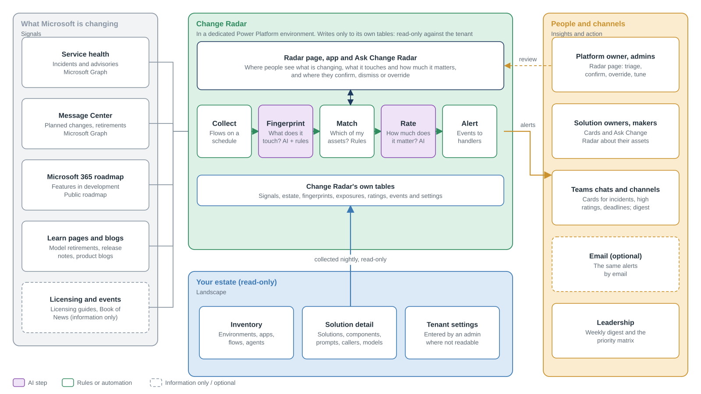
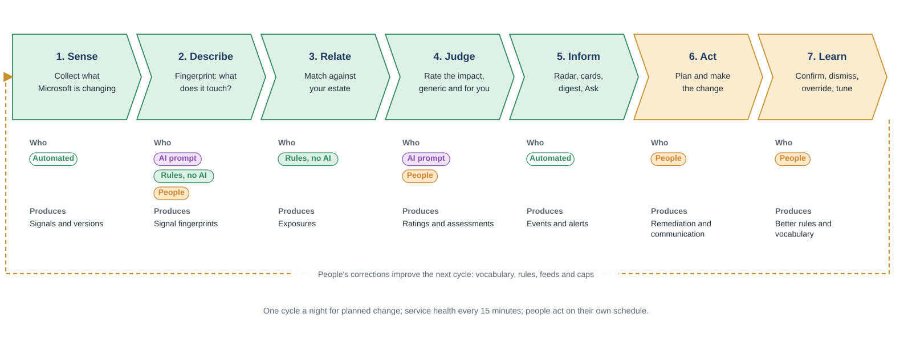
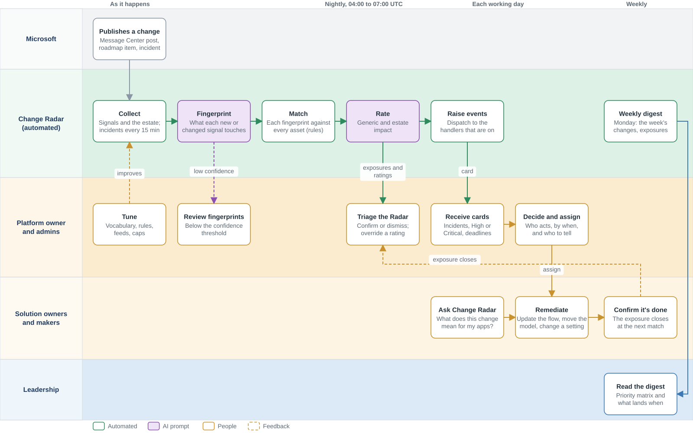
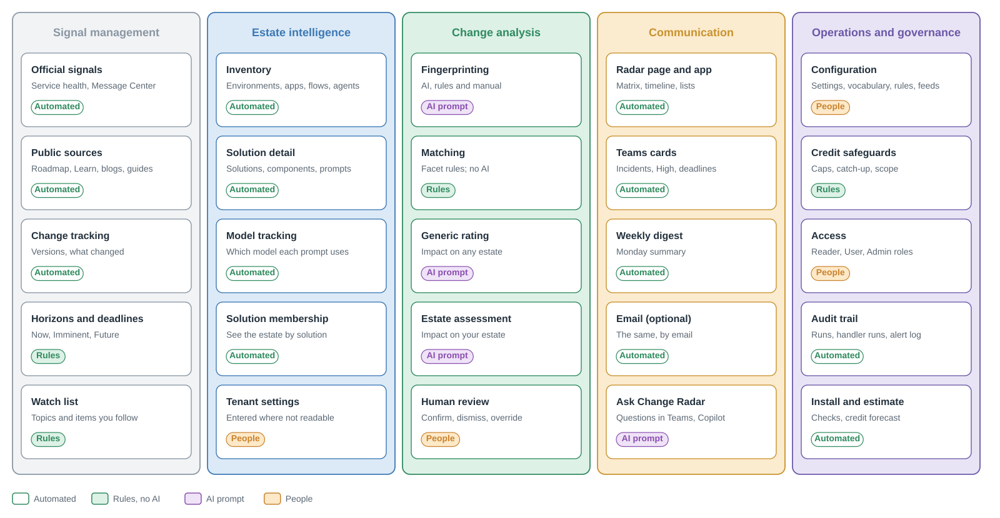
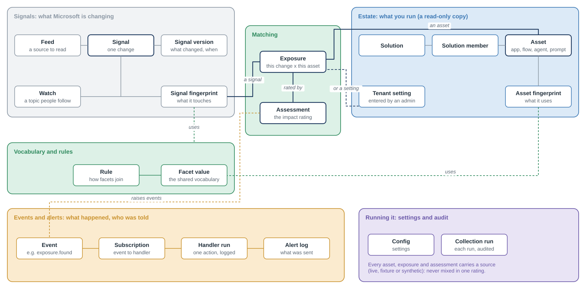
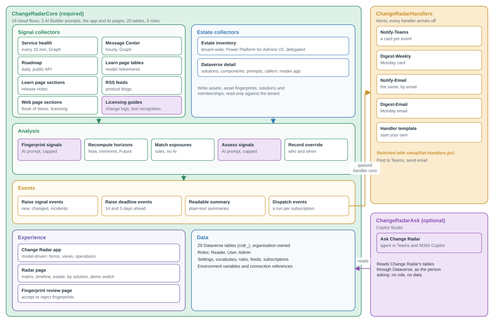
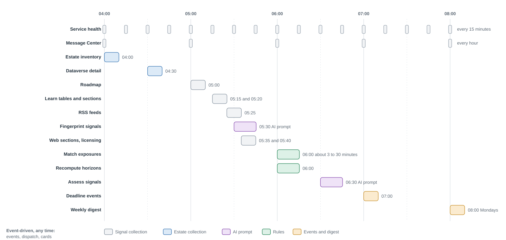
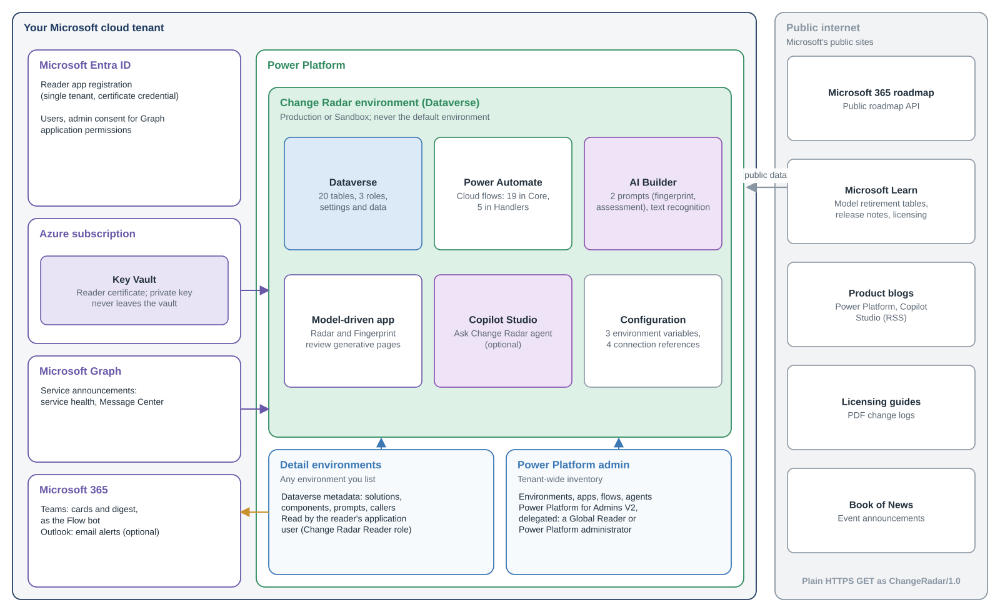
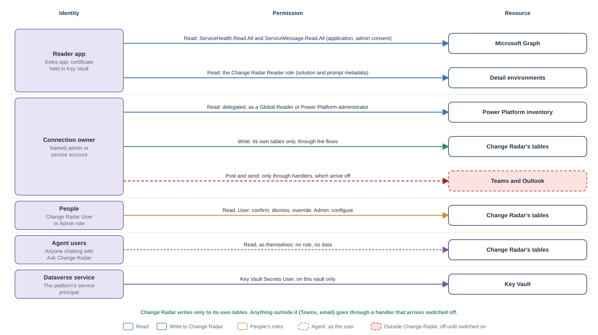
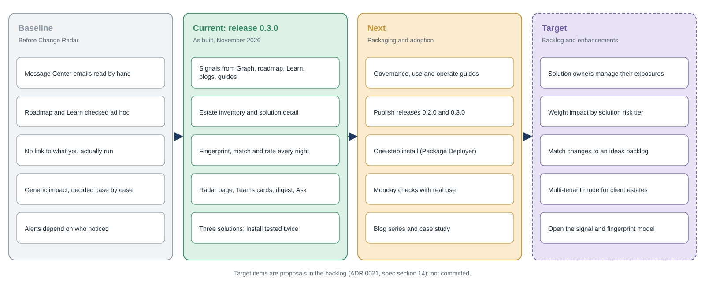

# Change Radar: Architecture Definition

> **For:** platform owners, enterprise and solution architects, security reviewers, and anyone deciding whether to adopt Change Radar. **Kind:** explanation and reference.
> **As built:** release 0.3.0, 24 November 2026. Every list in this document comes from the repository's generated artefacts (flows, schema, solution exports, setup scripts) and from two clean install tests, not from intention.
>
> **From:** [Empower Your World](https://www.empoweryour.world/?utm_source=github&utm_medium=docs&utm_campaign=change-radar&utm_content=architecture) · [The story behind Change Radar](https://www.empoweryour.world/blog/change-radar?utm_source=github&utm_medium=docs&utm_campaign=change-radar&utm_content=architecture)

## 1. Introduction

### 1.1 Purpose

Microsoft changes Power Platform, Copilot Studio and Microsoft 365 Copilot every week: features arrive, models retire, licensing moves, services have incidents. Most organisations learn about a change that affects them when something breaks or a deadline passes. **Change Radar** watches what Microsoft is changing, works out which of your own apps, flows, agents, prompts and settings each change touches, rates how much it matters to you, and tells the right people in time to act.

This document describes the architecture of Change Radar as built: the business process it supports, the data it holds, the applications that do the work, the technology they run on, and how it is secured and governed. It is written so that an architecture review board, a security reviewer or a platform owner can decide whether to adopt it, and so that the people who run it can see how the parts fit together.

### 1.2 How this document is organised

The document follows the structure of TOGAF's Architecture Development Method (ADM) and its four architecture domains. TOGAF terms are used where they help, and explained where they're first used.

| TOGAF phase or domain | What it answers | Section |
|---|---|---|
| Preliminary | The principles every design decision follows | 3 |
| A. Architecture Vision | Why Change Radar exists, for whom, and its boundaries | 2 |
| B. Business Architecture | The process it supports, the capabilities and the roles | 4 |
| C. Information Systems Architecture: data | What it stores, where it comes from, how it's labelled | 5 |
| C. Information Systems Architecture: application | The components, how they interact, and when they run | 6 |
| D. Technology Architecture | The platform services, environments and deployment | 7 |
| Security (across all domains) | Identities, permissions and threats | 8 |
| Requirements Management | Requirements, constraints and how they're met | 9 |
| E and F. Opportunities, Solutions and Migration Planning | Baseline, current and target, and the gaps between them | 10 |
| G and H. Implementation Governance and Change Management | The decision register and how changes are controlled | 11 |

### 1.3 Scope

**In scope:** the three Change Radar solutions (`ChangeRadarCore`, `ChangeRadarHandlers`, `ChangeRadarAsk`), the identities and Azure resources the setup scripts create, the seed data, and the operational tooling (install check, credit estimate, release build).

**Out of scope:** the Microsoft services Change Radar reads (their architecture is Microsoft's), the organisation's own estate (Change Radar reads it but never changes it), and enhancements in the backlog that aren't built (section 10).

### 1.4 Status and evidence

Release 0.3.0 has been built and proved in a development environment and by two clean install tests: a fresh install from the release files into a new environment, and an upgrade of an existing install. Where a statement depends on Microsoft's documentation, it was checked on Microsoft Learn on the date given in the referenced document. Statements marked **assumption** have not yet been proved.

## 2. Architecture vision

### 2.1 The problem

A platform team responsible for Power Platform and Copilot faces three gaps:

- **Volume.** Message Center alone publishes dozens of posts a week across the services in scope; the roadmap, Learn release notes, product blogs and licensing guides add more. Reading them all is a part-time job.
- **Relevance.** A generic change notice doesn't say whether it touches anything you run. "A model retires on 30 November" matters only if one of your prompts or agents uses it.
- **Timeliness.** By the time someone connects a change to an affected asset, the deadline has often passed, and the person who owns the asset was never told.

### 2.2 The vision

Change Radar answers three questions, continuously, for the estate it's installed in:

1. **What is changing?** Incidents now, planned changes soon, roadmap items further out.
2. **Does it touch anything we run?** Each change is matched against the actual estate: environments, solutions, apps, flows, agents, prompts, connectors, models and settings.
3. **So what?** The impact is rated for this estate, not a generic one, the affected assets are named with the evidence, and the right people are told what to do.

It does this **read-only against the tenant**, inside the organisation's own Microsoft cloud, with every rating labelled as an AI assessment and every match backed by evidence.

### 2.3 Stakeholders and concerns

| Stakeholder | Concern | Where it's addressed |
|---|---|---|
| Platform owner, Centre of Excellence | See every relevant change early; prioritise; prove the estate is managed | Sections 4, 6.6 |
| Power Platform and Microsoft 365 admins | Know what needs action and by when; keep noise low | Sections 4.2, 6.4 |
| Solution owners and makers | Hear about changes to their own assets, with what to do | Sections 4.2, 6.6 |
| Leadership | A weekly view of risk and opportunity | Sections 4.2, 6.6 |
| Security and compliance | Least privilege; no data leaving Microsoft services; no writes to the estate | Section 8 |
| Enterprise architecture | Fit with the platform; supportable; configurable without code | Sections 7, 11 |
| Finance and licensing | Predictable AI credit use and licences | Section 7.4 and the requirements guide |

### 2.4 System context

Change Radar sits between two things it doesn't own: **what Microsoft is changing** (signals) and **what you run** (the estate, or landscape). It reads both, and writes only to its own tables. People see the results on the Radar page and in Teams, and act on them; their corrections flow back into the next cycle.

### 2.5 Outcomes

- Every change in scope is collected, described and dated, without anyone reading Message Center by hand.
- Every change that touches the estate produces an **exposure** naming the asset, the matched facet and the rule, so nobody has to take an AI's word for it.
- High and Critical impacts, incidents and approaching deadlines reach a named person in Teams the same day.
- A weekly digest and a priority matrix give leadership one view of what lands when.

## 3. Architecture principles

These principles constrain every design decision. They come from the build specification and are enforced by tests and checks where possible.

| Principle | Statement | Rationale | Implications |
|---|---|---|---|
| **Read-only against the tenant** | Change Radar never changes the estate it reads. | Trust: adopters can install it without a change-control risk. | Every identity reads only; writes go to Change Radar's own tables; anything that writes elsewhere is a handler that ships switched off. |
| **Evidence before interpretation** | Every exposure names the asset, the field that matched and the rule; AI output is labelled as assessment. | People must be able to verify a claim before acting on it. | Matching uses rules, not AI; ratings show their rationale and can be overridden. |
| **Estate data stays in the tenant** | No estate metadata leaves Microsoft services. | Data protection and sovereignty. | The AI runs as AI Builder prompts in the organisation's own environment; there is no external AI service and no product telemetry. |
| **Built to be installed by others** | Nothing tenant-specific in the solutions. | It must work in any organisation without code changes. | Identities, thresholds, vocabulary, rules, sources and channels are configuration and seed data. |
| **Act through events** | Every meaningful change raises an event; actions subscribe to events. | New actions can be added without touching the core. | A dispatcher routes events to handlers; handlers live in their own solution. |
| **Official sources first** | Use Microsoft's APIs and documentation; fall back to public pages honestly. | Accuracy and supportability. | Graph for service health and Message Center; public sources are read as an identified client (`ChangeRadar/1.0`). |
| **Don't rebuild what Microsoft ships** | Use platform inventory and services where they exist. | Less to maintain. | Estate inventory comes from the Power Platform inventory; prompts run on AI Builder. |
| **People stay in and on the loop** | People review uncertain AI output before it's used, and can correct anything afterwards. | AI is fallible; accountability stays with people. | Low-confidence fingerprints wait for review; exposures can be confirmed or dismissed; ratings can be overridden. |
| **Live and synthetic data never mix** | Demo and test data are labelled and never combined with live data in one rating. | Demonstrations must not distort real decisions. | Every asset, exposure and assessment carries a source; the page shows one estate at a time. |
| **Cost is bounded** | AI use is capped per run and predictable. | Credits are a real and limited budget. | Per-run caps, a catch-up period for new installs, a credit estimate and a measured cost per call. |

## 4. Business architecture

### 4.1 The platform change loop

The work Change Radar supports is a loop: change arrives, it's understood and related to the estate, someone decides and acts, and what was learned improves the next cycle. Figure 2 shows the loop as a value stream, with who or what does each stage.

| Stage | What happens | Who or what | Produces |
|---|---|---|---|
| 1. Sense | Collect what Microsoft is changing, and what has changed since last time | Automated flows | Signals and signal versions |
| 2. Describe | Describe each new or changed signal in a shared vocabulary: product, resource type, connector, capability, authentication mode, harness, setting, environment type, model | AI prompt, rules for structured sources, people for low-confidence results | Signal fingerprints |
| 3. Relate | Compare each fingerprint with what every asset uses | Rules, no AI | Exposures |
| 4. Judge | Rate the impact: generic (for any estate) and for this estate | AI prompt; people can override | Ratings and assessments |
| 5. Inform | Show it on the Radar, post cards, send the digest, answer questions | Automated | Events and alerts |
| 6. Act | Decide, assign, remediate, communicate | People | Changes to the estate (outside Change Radar) |
| 7. Learn | Confirm or dismiss exposures, override ratings, tune vocabulary, rules, sources and caps | People | A better next cycle |

### 4.2 The change management process

Figure 3 shows the same loop as a process across the roles involved, and when each step happens.

**Each night (04:00 to 07:00 UTC),** Change Radar collects signals and refreshes its copy of the estate, fingerprints new and changed signals, matches them against the estate, rates them, and raises events. Service health is collected every 15 minutes, so an incident reaches Teams within the quarter hour.

**Each working day,** the platform owner or an admin triages the Radar: the priority matrix shows what's high impact and when it lands. They confirm or dismiss exposures, override a rating where the AI is wrong, review fingerprints below the confidence threshold, and decide who acts. Cards in Teams bring incidents, High or Critical ratings and approaching deadlines to them without opening the app.

**When an action is assigned,** the solution owner or maker remediates: updates a flow, moves a prompt to a supported model, changes a connector or a setting. They can ask Ask Change Radar what a change means for their apps. At the next nightly match, an exposure whose asset no longer matches closes by itself.

**Every Monday,** the weekly digest summarises the week's new and changed signals, exposures and ratings, and leadership sees the priority matrix and what lands when.

| Activity | Change Radar | Platform owner, admins | Solution owners, makers | Leadership |
|---|---|---|---|---|
| Collect and describe changes | Does | Tunes sources and vocabulary | | |
| Match to the estate | Does | Confirms or dismisses | | |
| Rate the impact | Proposes | Overrides where needed | | |
| Alert | Sends | Receives, assigns | Receives | |
| Remediate | Closes the exposure when it's fixed | Decides and tracks | Does | |
| Review the week | Sends the digest | Reviews | | Reviews |

### 4.3 Business capabilities

Figure 4 maps what Change Radar can do into five capability areas, marked by whether each is automated, rule-based, AI-assisted or done by people.

### 4.4 Roles

| Role | Who, typically | Responsibilities | Change Radar access |
|---|---|---|---|
| Platform owner | Head of the Power Platform service or CoE | Owns Change Radar; triages; decides | Change Radar Admin |
| Admin | Power Platform or Microsoft 365 admin | Triage, review, configuration | Change Radar Admin or User |
| Solution owner, maker | Owner of apps, flows or agents | Remediates their assets | Change Radar User; Ask Change Radar |
| Leadership | Head of digital, IT leadership | Reviews the weekly picture | Digest; Change Radar User to open the app |
| Connection owner | A named admin or service account | The account the flows run as | Owns the connections (section 8) |
| Installer | Power Platform admin, with Entra and Azure help once | Installs and upgrades | System Administrator at install |

### 4.5 How the architecture supports the process

The matrix maps each process stage to the application components that carry it out (section 6).

| Process stage | Application components |
|---|---|
| Sense | Signal collectors (8 flows), estate collectors (2 flows), Raise signal events |
| Describe | Fingerprint signals (AI prompt), Learn page tables (rule fingerprints), Fingerprint review page |
| Relate | Match exposures; vocabulary and rules (data) |
| Judge | Assess signals (AI prompt), Record override, Radar page |
| Inform | Raise deadline events, Dispatch events, Notify-Teams, Digest-Weekly, Notify-Email, Digest-Email, Radar page, Ask Change Radar |
| Act | Outside Change Radar (the organisation's own change process) |
| Learn | Radar page and app forms (confirm, dismiss, override), configuration (settings, vocabulary, rules, feeds), Set-Handlers |

## 5. Data architecture

### 5.1 Conceptual data model

Change Radar keeps its data in twenty Dataverse tables, all prefixed `crdr_` and organisation-owned, in its own environment. Figure 5 shows them in five groups. The central idea is the **exposure**: the meeting point of one change and one asset (or one tenant setting).

### 5.2 Data entity catalogue

| Group | Entity | Holds | Written by |
|---|---|---|---|
| Signals | Signal | One change Microsoft is making: title, source, dates, horizon, ratings | Collectors; Assess signals |
| | Signal version | Each version of a signal, and which fields changed | Collectors |
| | Signal fingerprint | What a signal touches, as facet values, with confidence and status | Fingerprint signals; rules; people (review) |
| | Feed | A public source and how to read it | Seed data; admins |
| | Watch | A topic people follow | Admins |
| Estate | Asset | An app, flow, agent or prompt, with its environment and source | Estate collectors |
| | Asset fingerprint | What an asset uses: connectors, capabilities, models | Estate collectors |
| | Solution, Solution member | Solutions and which assets they hold | Dataverse detail |
| | Tenant setting | A setting Change Radar can't read, entered by an admin | Admins |
| Matching and rating | Facet value | The shared vocabulary | Seed data; admins |
| | Rule | How a signal facet joins an asset facet | Seed data; admins |
| | Exposure | This change touches this asset (or setting): the matched group and evidence | Match exposures; people (confirm, dismiss) |
| | Assessment | The impact rating for an estate, with rationale and recommended action | Assess signals; people (override) |
| Events and alerts | Event | Something happened, such as `exposure.found` | Event flows |
| | Subscription | Which events go to which handler | Seed data; Set-Handlers |
| | Handler run | One handler's action on one event, and its outcome | Dispatch events; handlers |
| | Alert log | What was sent, to whom, when | Handlers |
| Running it | Config | Settings, including credit caps and the demo data switch | Seed data; admins |
| | Collection run | Each run of each collector, with counts and gaps | Every collector |

### 5.3 Sources and lineage

| Source | Read by | Becomes |
|---|---|---|
| Microsoft Graph service announcements (service health, Message Center) | Collect service health, Collect Message Center, as the reader app | Signals, versions |
| Microsoft 365 roadmap (public API) | Collect roadmap | Signals, versions |
| Microsoft Learn (model retirement tables, release notes, licensing pages) | Learn page tables and sections, web page sections | Signals, rule fingerprints |
| Product blogs (RSS), Book of News, licensing guide change logs | RSS feeds, web page sections, licensing guides (text recognition) | Signals (licensing and announcements are information only, never rated) |
| Power Platform inventory | Collect estate inventory, as the connection owner (delegated) | Assets, asset fingerprints |
| Dataverse of each detail environment (solutions, components, prompts, callers) | Collect Dataverse detail, as the reader app | Assets (prompts), fingerprints, solutions, members |
| Admins | The app | Tenant settings, vocabulary, rules, feeds, watches, overrides |

### 5.4 Classification, residency and labelling

- **Residency.** All data stays in the organisation's Dataverse. Change Radar sends nothing to any service outside Microsoft's cloud, and has no telemetry.
- **Content.** Signals are public or tenant-published Microsoft content. Estate data is metadata about the organisation's apps, flows, agents and prompts (names, types, environments, connectors, models, owners' solution membership), not business data inside them.
- **Source labels.** Every asset, exposure and assessment carries a **source**: `live` (the real estate), `fixture` (test resources in a development environment) or `synthetic` (the demo organisation). They are never mixed in one rating. The Radar page shows one estate at a time: the demo organisation while demo data is on, the live estate while it's off.
- **History.** Signals keep their versions; collection runs, handler runs and the alert log form an audit trail.

## 6. Application architecture

### 6.1 Application components

Change Radar is three Power Platform solutions. Figure 6 shows their components and how work moves between them.

| Solution | Holds | Required? |
|---|---|---|
| `ChangeRadarCore` | 20 tables, 19 cloud flows, 2 AI Builder prompts, the model-driven app with the Radar and Fingerprint review pages, 3 security roles, 3 environment variables, 2 connection references | Yes |
| `ChangeRadarHandlers` | Notify-Teams, Digest-Weekly, Notify-Email, Digest-Email, a Handler template, and the Teams and Outlook connection references. Every handler arrives switched off | For alerts |
| `ChangeRadarAsk` | The Copilot Studio agent Ask Change Radar and its Dataverse connection reference | Optional |

Handlers depend on Core; Core never depends on Handlers. Core installed alone gives the Radar, the app and Ask, with no alerts.

### 6.2 Application component catalogue

| Component | Kind | Trigger | Does |
|---|---|---|---|
| Collect service health, Message Center | Cloud flows | Every 15 minutes, hourly | Read Graph service announcements; write signals and versions |
| Collect roadmap; Learn page tables and sections; RSS feeds; web page sections; licensing guide change logs | Cloud flows | Daily, 05:00 to 05:40 | Read public sources described by each feed's profile; write signals |
| Collect estate inventory | Cloud flow | Daily, 04:00 | Read the tenant-wide Power Platform inventory; write assets and fingerprints |
| Collect Dataverse detail | Cloud flow | Daily, 04:30 | Read solutions, components, prompts and their callers in each detail environment |
| Fingerprint signals | Cloud flow with an AI Builder prompt | Daily, 05:30 | Describe new and changed signals in the vocabulary; capped per run |
| Recompute horizons | Cloud flow | Daily, 06:00 | Place each signal in Now, Imminent or Future |
| Match exposures | Cloud flow, rules only | Daily, 06:00 | Compare fingerprints with assets; open, update or close exposures |
| Assess signals | Cloud flow with an AI Builder prompt | Daily, 06:30 | Rate generic and estate impact; capped per run |
| Raise signal events, Raise deadline events, Record override, Readable summary | Cloud flows | Dataverse triggers; daily at 07:00 for deadlines | Raise events; record who overrode a rating; write plain-text summaries |
| Dispatch events | Cloud flow | A new event | Create a queued handler run for each matching, enabled subscription |
| Handlers | Cloud flows (ChangeRadarHandlers) | A queued run (Notify) or Monday 08:00 (Digest) | Post a card or send an email; mark the run Succeeded or Failed |
| Change Radar app | Model-driven app | People | Forms, views and operations for every table |
| Radar page | Generative page | People | Priority matrix, what lands when, estate by solution, demo data switch |
| Fingerprint review page | Generative page | People | Accept or reject fingerprints below the threshold |
| Ask Change Radar | Copilot Studio agent | People, in Teams or Microsoft 365 Copilot | Answer questions from Change Radar's tables, as the person asking |

### 6.3 Matching and rating

**Fingerprints** describe a signal in a shared vocabulary of nine facets: product, resource type, connector, capability, authentication mode, harness, setting, environment type and model. The fingerprint prompt proposes facets with a confidence; those below the threshold (0.7 by default) wait for a person. Structured sources such as Learn's model retirement tables are fingerprinted by rule, without AI.

**Matching** is deterministic. A fingerprint is a set of groups; within a group every facet must match (AND), and groups are alternatives (OR). A rule says how a signal facet joins an asset facet. A match is an exposure, recorded with the group and the evidence. No AI is involved, so the same inputs always give the same exposures.

**Rating** has two parts. The **generic impact** says how much a change matters to any estate. The **estate impact** says how much it matters here, from the exposed assets, with weight added for production environments and near deadlines. The generic impact comes from the assessment prompt; the estate impact is computed from it by rules (plus one for a production asset, plus one if action is due within 30 days, capped at Critical). Ratings are labelled as AI assessments; a person can override any rating, with a reason, and the override is recorded.

### 6.4 Event-driven integration

Every meaningful change raises an event. The dispatcher looks up the enabled subscriptions for the event's type and creates one queued **handler run** per subscription. Each handler triggers on its own runs, acts, and records the outcome. The dispatcher never calls a handler directly, so the core never depends on any handler, and an organisation can add its own (a Planner task, a ServiceNow ticket) from the Handler template without changing the core.

| Event | Raised when | Typical handlers |
|---|---|---|
| `signal.new`, `signal.changed` | A signal appears or a key field changes | Weekly digest |
| `incident.opened`, `incident.resolved` | A service incident starts or ends (not one already over when first seen) | Teams card |
| `exposure.found` | A change touches an asset | Weekly digest |
| `assessment.rated` | A rating is set or overridden | Teams card if High or Critical; weekly digest |
| `deadline.approaching` | An action date with live exposure is 14 or 3 days away | Teams card |
| `asset.modelchanged` | An agent's or prompt's model changes without anyone editing it | Teams card; weekly digest |
| `watch.matched`, `watch.updated` | A signal matches a watched topic, or a watched signal changes | Teams card; weekly digest |

Handlers that write anything outside Change Radar ship switched off, and their documentation says what they write, where and as whom.

### 6.5 The nightly orchestration

The order matters: the estate is refreshed before matching, signals are collected before fingerprinting, fingerprints exist before matching, and exposures exist before rating. Event-driven flows (signal events, dispatch, cards) run whenever their trigger fires. A full night's run takes about 15 minutes in a test environment; matching takes longest as the estate grows.

### 6.6 User experience

- **The Radar page** opens on two visuals: a **priority matrix** (impact against time to land) and **what lands when** (a weekly timeline). Detailed sections (exposed estate, by solution, incidents, lists) are collapsed until needed. A Solution filter scopes every section to one solution, including signals related to its components. An admin can switch demo data on or off from the header.
- **Teams cards** bring incidents, High or Critical ratings, deadlines, model changes and watch matches to a chat or channel; the **weekly digest** summarises the week every Monday.
- **The Change Radar app** gives forms and views for every table, and the operations pages for settings, vocabulary, rules, sources and subscriptions.
- **Ask Change Radar** answers questions in Teams or Microsoft 365 Copilot, reading Change Radar's data as the person asking.

## 7. Technology architecture

### 7.1 Platform services

Change Radar runs entirely on Microsoft cloud services in the organisation's own tenant. Figure 8 shows the services and where they sit.

| Technology component | Used for | Notes |
|---|---|---|
| Dataverse | Change Radar's tables, roles and settings | A dedicated environment; never the default environment |
| Power Automate | All 24 cloud flows | Run as the connection owner, who needs Power Automate Premium |
| AI Builder | The fingerprint and assessment prompts; text recognition for licensing guides | Billed in AI Builder credits or Copilot Credits |
| Model-driven apps, generative pages | The app, the Radar page, the Fingerprint review page | People need premium Power Apps use rights |
| Copilot Studio | Ask Change Radar (optional) | Copilot Credits per question if billed |
| Microsoft Graph | Service health and Message Center | Application permissions, read-only |
| Power Platform inventory | Tenant-wide estate | Power Platform for Admins V2, delegated |
| Microsoft Entra ID | The reader app registration | Single tenant, certificate credential |
| Azure Key Vault | The reader certificate | The private key is generated in, and never leaves, the vault |
| Microsoft Teams, Exchange Online | Cards, digest, email | Only through handlers, which arrive off |
| Public Microsoft sites | Roadmap, Learn, blogs, licensing guides, Book of News | Plain HTTPS GET as `ChangeRadar/1.0` |

### 7.2 Environments and deployment

- **The Change Radar environment** holds all three solutions. Production or Sandbox type for real use; Developer for evaluation.
- **Detail environments** are any other environments whose solutions and prompts Change Radar should read; each gets the reader's application user with the read-only Change Radar Reader role.
- **Deployment** is by managed solutions from a versioned release, imported in the order Core, Handlers, Ask. A deployment settings template per solution supplies environment variables and connections; tenant values never live in the repository. A set of PowerShell scripts creates what solutions can't carry: the reader identity in Entra ID and Azure, and the seed data.
- **Upgrades** import the new release over the installed one; Core is upgraded with `--stage-and-upgrade` so components it no longer contains are removed. Settings, data and handler states are kept.
- **Verification** is a read-only script, `Test-Install.ps1`, that checks the solution, flows, connections, settings, collectors, signals, identities and alerts after the first night.

### 7.3 Configuration

| Kind | Items |
|---|---|
| Environment variables | Tenant id; reader client id; the Key Vault reference to the reader certificate |
| Connection references | Dataverse and Power Platform for Admins V2 (Core); Teams and Office 365 Outlook (Handlers) |
| Settings | Polling, horizons, thresholds, rating scope, per-run caps and catch-up, alert recipient and destinations, detail environments, the demo data switch |
| Data | Vocabulary, rules, theme rules, sources (feeds), watch topics, manual fingerprints, subscriptions |

### 7.4 AI services and cost

| Use | Runs as | Cost | When |
|---|---|---|---|
| Fingerprinting | AI Builder prompt in the environment | About 5.5 AI Builder credits per call (about 0.46 Copilot Credits) | New or changed signals, capped per run |
| Rating | AI Builder prompt in the environment | About 5.5 AI Builder credits per call | New or changed signals and exposures, capped per run |
| Licensing guide text recognition | AI Builder | About 3 AI Builder credits per guide | Only when a guide changes |
| Ask Change Radar | Copilot Studio | About 10 Copilot Credits per question if billed | Optional |
| Matching | No AI | None | Nightly |

**Safeguards:** separate per-run caps on fingerprinting, rating and estate assessment (25 each by default); a 14-night catch-up at 100 so a new install clears Microsoft's backlog in about a week; the demo data switch; unrated sources never sent to a prompt. With the default caps a month cannot exceed about 12,400 AI Builder credits, and typically uses far less. The requirements guide has a worked estimate, and `Get-CreditEstimate.ps1` forecasts an installed environment's use from its own data.

### 7.5 Licensing summary

People who open the app need premium Power Apps use rights; the connection owner needs Power Automate Premium; AI use needs AI Builder credits or Copilot Credits allocated to the environment. The requirements guide gives the detail, with Microsoft Learn references.

## 8. Security architecture

### 8.1 Identities and permissions

| Identity | Can | On | Granted by |
|---|---|---|---|
| Reader app (Entra app registration) | Read service health and Message Center (application permissions, admin consent) | Microsoft Graph | `New-ReaderIdentity.ps1`; a Privileged Role Administrator consents |
| | Read solution and prompt metadata (Change Radar Reader role) | Each detail environment | `New-ReaderIdentity.ps1` |
| Connection owner | Read the tenant inventory (delegated, Global Reader or Power Platform administrator) | Power Platform inventory | The connection |
| | Write Change Radar's own tables | The Change Radar environment | The Dataverse connection |
| | Post cards and send email, only through handlers that are switched on | Teams, Outlook | The Handlers connections |
| People | Read; a User can confirm, dismiss and override; an Admin can configure | Change Radar's tables | Change Radar User or Admin role |
| Agent users | Read, as themselves; without a role they see nothing | Change Radar's tables | Copilot Studio sharing |
| Dataverse service principal | Read the reader certificate | The Key Vault, only | Key Vault Secrets User |

### 8.2 Security by design

- **Least privilege.** The reader app has two read-only Graph permissions and a read-only Dataverse role (plus two SharePoint privileges Dataverse gives every role); the inventory connection needs only Global Reader; people get a User role that can't change settings (tested with a non-admin account: 32 of 32 checks).
- **No secrets in code or settings.** The reader authenticates with a certificate whose private key is generated in Key Vault and never leaves it; Dataverse reads it through a secret environment variable.
- **No writes outside Change Radar** except through handlers, which arrive switched off and are switched on deliberately with `Set-Handlers.ps1`, which names any handler that writes outside Change Radar.
- **No data egress.** The AI runs in the organisation's environment; there is no external service and no telemetry.
- **Honest automation.** Public sources are read with a plain GET that identifies itself; Change Radar never imitates a browser.
- **Release integrity.** Every release is built from a named commit, passes Microsoft's solution checker, scans for tenant identifiers, and publishes SHA-256 checksums.

### 8.3 Threats and mitigations

| Threat | Mitigation |
|---|---|
| Change Radar changes or breaks the estate | Read-only identities; writes only to its own tables; handlers off by default |
| A compromised reader credential | Certificate in Key Vault; two read-only Graph permissions; Dataverse role that only reads (plus two SharePoint defaults every role gets); single tenant |
| An AI rating is wrong and drives a bad decision | Ratings labelled as assessments with rationale; matching by rules with evidence; human override recorded |
| Low-quality fingerprints create noise | Confidence threshold with human review; vocabulary validation; rule-based fingerprints for structured sources |
| Demo data distorts real decisions | Source labels on every record; one estate shown at a time; demo data off by default |
| Uncontrolled AI spend | Per-run caps, catch-up limits, a monthly ceiling and a credit estimate |
| Alert floods | Already-resolved incidents raise no card; one card per event; digests for low-urgency events |
| Unauthorised access to Change Radar's data | Dataverse security roles; the agent reads as the user; no role, no data |

## 9. Requirements and constraints

### 9.1 Key requirements and how they are met

| Requirement | How it is met | Evidence |
|---|---|---|
| Collect what Microsoft is changing across Power Platform and Copilot | Graph and public collectors on a schedule | Install test: 773 signals on a first night |
| Relate each change to the actual estate | Inventory and Dataverse detail; fingerprints; rule-based matching | Exposures with evidence |
| Rate impact for this estate | Assessment prompt with estate context; overrides | Ratings with rationale |
| Tell the right people in time | Events, handlers, Teams cards, digest, deadline events | Test card delivered in both install tests |
| Install in any tenant without code | Configuration, seed data, deployment settings, managed solutions | Fresh install from the release files |
| Be read-only against the tenant | Read-only identities; own tables only | Permissions review; role tests |
| Keep AI cost predictable | Caps, catch-up, estimate | Measured cost per call |

### 9.2 Constraints

- Microsoft Power Platform with Dataverse is required; the default environment must not be used.
- The inventory query supports delegated authentication only, so one connection must belong to a Global Reader or Power Platform administrator.
- Graph application permissions need consent from a Privileged Role Administrator or Global Administrator.
- AI Builder credits are being replaced by Copilot Credits for new and renewed licences from November 2026.

### 9.3 Assumptions and known limitations

- **Assumption:** the data loss prevention grouping in the requirements guide (the connectors that must share a data group) holds against a real organisation's policy (to verify).
- Matching quality depends on the vocabulary and rules; new kinds of change may need new facet values.
- Tenant settings that Change Radar can't read must be entered by an admin.
- The Radar's "what lands when" depends on the dates Microsoft publishes, which can move.

## 10. Opportunities and roadmap

### 10.1 Baseline, current and target

### 10.2 Gap analysis

| From | To | Gap | Status |
|---|---|---|---|
| Manual reading of notices | Automated collection | Collectors, versions, horizons | Closed in 0.3.0 |
| Generic impact | Impact on this estate | Inventory, fingerprints, matching, estate rating | Closed in 0.3.0 |
| Ad hoc alerts | Events to the right people | Events, dispatch, handlers, digest | Closed in 0.3.0 |
| Admin-centred tool | Solution owners manage their own exposures | Ownership, delegation, licensing (ADR 0021) | Proposed |
| Impact by environment | Impact weighted by solution risk tier | Link to a risk-sizing app | Proposed |
| "What could this break?" | "What could this enable?" | Ideas backlog matching | Proposed |
| One tenant | Client estates | Multi-tenant mode | Proposed |

### 10.3 Transition

The next transition is adoption: the governance, use and operations guides, publishing releases 0.2.0 and 0.3.0, and a one-step installer (Package Deployer) that bundles the solutions and seed data. Target items are proposals in the backlog, not commitments.

## 11. Architecture governance

### 11.1 Decision register

Significant decisions are recorded as Architecture Decision Records (ADRs) in the repository's `docs/decisions` folder.

| ADR | Decision | Status |
|---|---|---|
| 0001 | A dedicated repository, private until release | Accepted |
| 0002 | The name: Change Radar | Accepted |
| 0003 | Publisher and table prefix (`crdr_`) | Accepted |
| 0004 | Where the LLM runs: in the tenant, as AI Builder prompts | Accepted |
| 0005 | The dashboard surface | Accepted |
| 0006 | Languages for local tooling | Accepted |
| 0007 | Signal horizons | Accepted |
| 0008 | Estate inventory | Accepted |
| 0009 | Matching | Accepted |
| 0010 | Assessment | Accepted |
| 0011 | Events and alerts | Accepted |
| 0012 | The Radar page and signal-level ratings | Accepted |
| 0013 | Model-change signals | Accepted |
| 0014 | Adding a signal source | Accepted |
| 0015 | The watch list | Accepted |
| 0016 | Copilot Studio for the AI workload | Accepted |
| 0017 | The flows and agents that call a prompt | Accepted |
| 0018 | Event announcements as a source | Accepted |
| 0019 | Licensing guide changes as a source | Accepted |
| 0020 | The estate by solution | Accepted |
| 0021 | Delegating exposures to solution owners | Proposed |
| 0022 | Packaging and documentation for adopters | Proposed |
| 0023 | The handlers' own solution | Accepted |
| 0024 | Apache License 2.0 | Accepted |
| 0025 | The documentation suite, and what stays out of the public package | Accepted |

### 11.2 How Change Radar itself is changed

- **Phase by phase,** each with a written "done when" that must be demonstrated before the next starts.
- **Tests first.** Expected cases are written before the rule that satisfies them; the engine's test suites, the Radar page's parity tests and the flows' generator keep logic in step.
- **Generated, not hand-edited.** Flows are generated from a script and every export is checked against the generator.
- **Install tests.** Each release is proved by installing it, fresh and as an upgrade, and running `Test-Install.ps1`.
- **Reviewed merges.** Every change reaches the main branch through a reviewed pull request.

### 11.3 Compliance checks

| Check | What it enforces |
|---|---|
| Export scan | No tenant identifiers, environment URLs or email addresses in the repository |
| Flow parity | Every exported flow matches the generator |
| Role check | Every security role reads exactly the solution's own tables |
| Core check | No handler or Teams or Outlook reference in the core solution |
| Solution checker | Microsoft's checker on every release; findings reviewed |
| Install check | `Test-Install.ps1` after the first night |

## Appendix A. Glossary

| Term | Meaning |
|---|---|
| ADM | TOGAF's Architecture Development Method: the phases this document follows |
| Assessment | An impact rating of a signal for one estate, with rationale and recommended action |
| Asset | Something the organisation runs: an app, flow, agent or prompt |
| Connection owner | The account Change Radar's flows run as |
| Detail environment | An environment whose solutions and prompts Change Radar reads |
| Event | A record that something meaningful happened, such as an exposure being found |
| Exposure | The meeting point of one change and one asset or setting, with evidence |
| Facet | One dimension of the vocabulary, such as connector or model |
| Fingerprint | A description of a signal or asset in the vocabulary |
| Handler | A flow that acts on events, such as posting a Teams card |
| Horizon | When a change lands: Now, Imminent or Future |
| Signal | One change Microsoft is making |
| Source (of a record) | Live, fixture or synthetic: never mixed in one rating |

## Appendix B. Related documents

| Document | For |
|---|---|
| Requirements | Roles, permissions, licences and credits, with a credit estimate |
| Install | Installing, turning on alerts, upgrading and uninstalling |
| Configure | Every setting, variable and connection |
| Extend | Adding sources, rules and handlers |
| Releases | Each release, its checksums and its changes |
| Install test log | The evidence from the clean install tests |
| Decisions | The Architecture Decision Records listed in section 11.1 |
