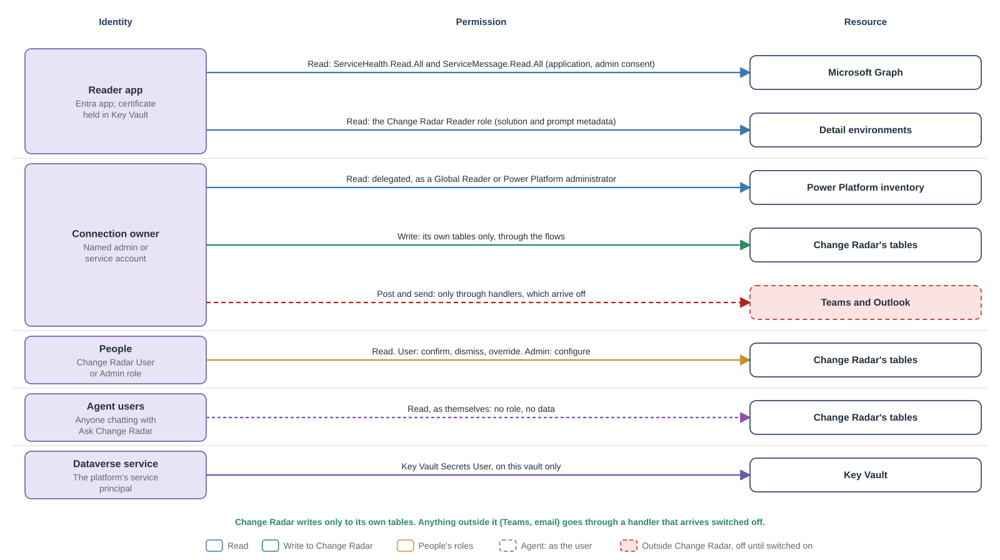

# Security and data handling

> **For:** security reviewers, the Centre of Excellence, data protection and IT risk. **Kind:** reference.
> **Status:** as built in release 0.3.0 and proved by two clean installs (24 November 2026). It answers one question: what does Change Radar read, write, store and send, as whom, and at what cost? Every identity and permission here is one the install creates; nothing else is needed.
>
> **From:** [Empower Your World](https://www.empoweryour.world/?utm_source=github&utm_medium=docs&utm_campaign=change-radar&utm_content=permissions-and-data) · [The story behind Change Radar](https://www.empoweryour.world/blog/change-radar?utm_source=github&utm_medium=docs&utm_campaign=change-radar&utm_content=permissions-and-data)

**In your organisation.** A tool that watches the whole Power Platform estate needs broad visibility, and that is exactly what a security reviewer should be wary of. Change Radar takes the opposite approach to most estate tools: it reads, it never writes to the estate, and every identity it uses is the least that Microsoft's APIs accept. Its rules are data you can inspect, and its behaviour is the same in every tenant. For a wider view of governance that is written as rules and data, not as documents, see [Governance as Code](https://www.empoweryour.world/modellibrary/11-governance-as-code?utm_source=github&utm_medium=docs&utm_campaign=change-radar&utm_content=permissions-and-data) on Empower Your World.

## 1. Summary

| Question | Answer |
|---|---|
| What does it read? | Microsoft's change announcements (service health and Message Center through Microsoft Graph; the public roadmap, Learn pages, blogs and licensing guides), and metadata about the organisation's apps, flows, agents and prompts (the Power Platform inventory, and solution and prompt detail in the environments you name) |
| What does it write? | Only its own tables, in its own environment. Nothing in the estate is changed |
| What does it store? | Signals, the estate's metadata (names, types, environments, connectors, models, owners' Entra object ids), what each change touches, ratings and their reasons, events, run logs and an alert log. No business data from inside apps or flows |
| What does it send, and where? | AI prompts run by Microsoft in the environment's AI Builder service receive Microsoft's announcement text and facet counts, never asset, owner or environment names. Alerts, if you switch them on, go only to the Teams chats, channels and email addresses you set |
| As whom? | A reader app (read-only Graph and Dataverse permissions, certificate in Key Vault), and a connection owner whose connections the flows use |
| Anything outside Microsoft's cloud? | No. Public pages are read with a plain request that identifies itself. There is no telemetry |

## 2. Identities and permissions

| Identity | Permission | On | Why | How to revoke |
|---|---|---|---|---|
| **Reader app** (Entra app registration, certificate credential) | `ServiceHealth.Read.All` and `ServiceMessage.Read.All`, application permissions with admin consent | Microsoft Graph | Service health and Message Center | Remove the consent or delete the app registration |
| | **Change Radar Reader** role: organisation-level read only (section 3) | Each detail environment (`detail_environments`) | Solution, prompt and caller detail | Remove the application user from the environment |
| **Connection owner** (a named admin or service account) | Query Power Platform resources, delegated; the account is a **Global Reader** (or a Power Platform administrator) | Power Platform inventory, tenant-wide | The estate inventory. The inventory API accepts only a signed-in user, not a service principal | Delete the connection |
| | Write Change Radar's own tables (System Administrator in the Change Radar environment today) | The Change Radar environment | The flows record signals, exposures, ratings and events | Delete the connection; the flows stop |
| | Post cards to Teams; send email (Office 365 Outlook) | The destinations in `alert_destinations` | Alerts, only from handlers that are switched on | Switch the handler off (`Set-Handlers.ps1 -Off`), or delete the connection |
| **People** | **Change Radar User**: read every table; set an exposure's status, an override, a signal's Watched flag and a fingerprint's review status. **Change Radar Admin**: configure settings, rules, vocabulary, feeds and subscriptions | Change Radar's tables | Using and running it | Remove the role |
| **People asking Ask Change Radar** (optional) | Read, **as themselves**, through the Dataverse MCP tool with only `read_query` and `describe` switched on | Change Radar's tables | Questions in Teams and Microsoft 365 Copilot. Without a Change Radar role, they get no data (tested) | Stop sharing the agent |
| **Dataverse service principal** | Key Vault Secrets User | The reader's Key Vault only | Dataverse reads the reader's certificate through a secret environment variable | Remove the role assignment |

The **User** role was tested with a real account holding only Basic User and Change Radar User: 32 of 32 checks passed, including refusals (HTTP 403) to change settings, feeds or rules.

## 3. The reader's Dataverse role

Organisation-level **read** on the tables below. `setup/New-ReaderIdentity.ps1` grants it and `setup/Test-ReaderIdentity.ps1` proves it, failing on any create, write, delete, append, assign or share privilege, with one exception: the two platform defaults described under the table.

| Privilege | Tables it reads | Why |
|---|---|---|
| `prvReadcrdr_*` | Change Radar's own tables | Its configuration and records |
| `prvReadSolution`, `prvReadPublisher` | Solutions and publishers | Which solutions hold each asset, and whether Microsoft or a maker published them |
| `prvReadbot`, `prvReadbotcomponent` | Agents and their components | Agent detail |
| `prvReadWorkflow`, `prvReadconnectionreference` | Flows and connection references | Component detail; which flows call a prompt |
| `prvReadCanvasApp` | Canvas apps | Which apps use a maker-built code component |
| `prvReadmsdyn_AIModel` | Prompts (and their run configuration) | Which model each prompt uses, so a model retirement shows which prompts it touches |

**Flow definitions.** For each flow that contains an AI Builder action, the detail step reads the definition, keeps only the operation name and the id of the prompt it calls, and records "this flow calls this prompt on this model". The definition itself is never stored, logged or sent anywhere.

**Platform defaults.** Dataverse adds nine baseline privileges to every new security role, and they can't be left out: read on plug-in and SDK metadata and on SharePoint documents and data, plus **create and write on SharePoint data** (`prvCreateSharePointData`, `prvWriteSharePointData`). Basic User and the other standard roles have the same two. `Test-ReaderIdentity.ps1` allows exactly these two and fails on any other. They are understood to back the SharePoint documents grid and hold no Change Radar data (**to verify**). They apply to the Change Radar User and Reader roles alike.

## 4. What is stored

All data stays in Change Radar's own Dataverse environment, in twenty tables prefixed `crdr_`, owned by the organisation.

| Data | Examples | Personal data? |
|---|---|---|
| Signals and their versions | Message Center posts, roadmap items, incidents, retirements | No. Message Center text is published to your tenant by Microsoft, so treat it as internal |
| The estate | Asset names, types, environments, connectors, models, solution membership | **Yes, indirectly:** each asset records its owner's **Entra object id** (not a name or email), and asset names sometimes contain a person's name |
| What changes touch | Fingerprints, exposures, matched rules and evidence | No |
| Ratings and decisions | Assessments, rationale, recommended action, overrides with reasons | **Yes:** who overrode a rating (a Dataverse user), and the standard created by and modified by fields on every row |
| Alerts | The alert log: what was sent, to which destination, when | **Yes:** the chats, channels and email addresses you set |
| Settings | `alert_destinations`, `alert_recipient` | **Yes:** addresses or user ids of the people who receive alerts |
| Run logs | Collection runs, handler runs, events | No |

The [Data Protection](data-protection.md) screening covers the personal data in detail.

**Retention.** Change Radar keeps the estate current: it replaces fingerprints and solution memberships as the estate changes. It doesn't delete history. Signals and their versions, exposures (a resolved one is closed, not deleted), assessments, events, run logs and the alert log are kept until you delete them. Set your own retention with a Dataverse bulk delete job; a starting point is 13 months for run logs, handler runs, events and the alert log, and the life of the installation for signals, exposures and assessments, which are the audit trail of decisions.

## 5. What is sent, and where

| What | To | Contains | Never contains |
|---|---|---|---|
| **Fingerprint prompt** | AI Builder, in the environment (Microsoft-operated model) | A signal's title, products and summary: Microsoft's own announcement | Anything about your estate |
| **Rating prompt** | The same | The signal, and counts and facets of what it touches, for example "3 cloud flows, 2 in production, matched on capability scheduled_prompt" | Asset, owner or environment names |
| **Licensing guide text recognition** | AI Builder | Microsoft's public licensing guide PDF | Anything from the tenant |
| **Ask Change Radar** (optional) | Copilot Studio, Microsoft-operated model | The question, and the rows the asker's role allows the agent to read | Data the asker's role doesn't allow |
| **Alerts** (when switched on) | Teams chats and channels, email addresses in `alert_destinations` | Signal title, key date, up to five affected asset names, the recommended action | Anything to a destination you didn't set |
| **Public page reads** | Microsoft's public sites (roadmap, Learn, blogs, Book of News, licensing guides) | A plain GET or HEAD request identifying itself as `ChangeRadar/1.0` | Anything from the tenant |

**Where the AI runs.** Prompts run on Microsoft-operated models through AI Builder in the environment's region. Microsoft states that prompt inputs and outputs aren't used to train foundation models and aren't available to other customers or to the model's maker (Learn, 2026-11-24, [AI Builder architecture](https://learn.microsoft.com/ai-builder/ai-builder-architecture)). Where a model isn't deployed in the environment's region, Microsoft may process the prompt in another region only if an administrator has allowed data movement across regions for the environment (Learn, 2026-11-24, [Move data across regions](https://learn.microsoft.com/power-platform/admin/geographical-availability-copilot)). Check the model's availability for your region before you install. The [AI Use Statement](ai-use.md) covers the AI in detail.

**Not enabled:** an option to run prompts on a non-Microsoft model through Microsoft (ADR 0004, option A+) was considered and deferred. It would need an administrator to allow it, and could process data outside the EU Data Boundary.

## 6. What it writes outside its own tables

Nothing, unless you switch on a handler. Every handler ships switched off.

| Handler | Sends | Where | As whom |
|---|---|---|---|
| Notify-Teams | One card per incident, High or Critical rating, deadline at 14 and 3 days, model change and watch list match | Each `chat:` and `channel:` entry in `alert_destinations`, plus `alert_recipient` | The Flow bot, through the installer's Teams connection |
| Digest-Weekly | One card each Monday: new and changed signals, newly exposed assets, ratings, model changes, watch list items | The same | The same |
| Notify-Email, Digest-Email | The same as email | Each `email:` entry | The owner of the Office 365 Outlook connection: email comes from that mailbox |

- **Live estate only:** demo and test data is never posted or sent.
- **Choose destinations with care.** Asset names leave Dataverse only to the destinations you set. A channel is seen by everyone in its team, and email can be forwarded.
- With no destination set, nothing is sent and the handler run records why.
- A handler you write yourself that changes anything outside Change Radar must ship switched off and say what it writes, where and as whom (the Extend guide).

## 7. Security by design

- **Least privilege:** two read-only Graph permissions, a Dataverse role that only reads (plus two SharePoint defaults every role gets), Global Reader for the inventory, and a User role that can't change settings.
- **No secrets in code or settings.** The reader's certificate is generated in Key Vault and its private key never leaves it.
- **No writes to the estate.** Handlers are the only way anything leaves Change Radar, and they ship off.
- **No telemetry and no external services.**
- **Honest automation.** Public sources are read with a plain request that names itself. Change Radar never imitates a browser.
- **Demo data is labelled.** Every asset, exposure and rating carries its source (live, test fixture or demo), and they are never mixed in one rating. Demo data is off by default and refused in a Production environment.
- **Release integrity.** Each release is built from a named commit, passes Microsoft's solution checker, is exported through a check that scans the source for tenant identifiers, and publishes SHA-256 checksums.

## 8. Threats and mitigations

| Threat | Mitigation |
|---|---|
| Change Radar changes or breaks the estate | Read-only identities; writes only to its own tables; handlers off by default |
| The reader's credential is compromised | Certificate in Key Vault; two read-only Graph permissions; a Dataverse role that only reads (plus two SharePoint defaults every role gets); single tenant. Revoke by removing consent or the certificate |
| The connection owner's account is compromised | It is a Global Reader: it can read, not change, the tenant. Use a dedicated account with strong authentication and conditional access |
| Someone reads data they shouldn't | Dataverse security roles; the agent reads as the user; no role, no data |
| Alert content reaches the wrong people | Destinations set by an admin; handlers off by default; demo data never sent |
| An AI rating is wrong and drives a bad decision | See the [AI Use Statement](ai-use.md): matching by rules, AI ratings labelled and overridable |
| Uncontrolled AI spend | Per-run caps, a monthly ceiling and a credit estimate (Requirements) |

## 9. Reporting a vulnerability

See `SECURITY.md` in the repository. Never open a public issue containing tenant data.
