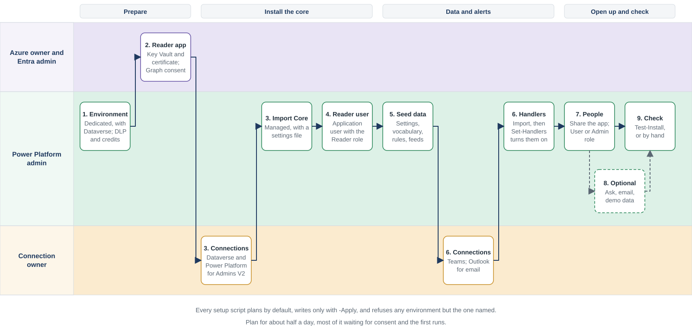

# Install

> **For:** the platform admin installing Change Radar. **Kind:** how-to.
> **Status:** proven by two clean installs on 24 November 2026 (`install-test-log.md`): run 1 installed the core, and run 2 added the alert handlers' own solution (ADR 0023), an upgrade in place and a fresh install with alerts on.
>
> **From:** [Empower Your World](https://www.empoweryour.world/?utm_source=github&utm_medium=docs&utm_campaign=change-radar&utm_content=install) · [The story behind Change Radar](https://www.empoweryour.world/blog/change-radar?utm_source=github&utm_medium=docs&utm_campaign=change-radar&utm_content=install)

Before you start, clear the checklist in [`prerequisites.md`](prerequisites.md): the people, licences, capacity and decisions you need. [`requirements.md`](requirements.md) gives the reasons and evidence. Plan for about half a day, most of it waiting for consent and the first runs.



## 1. Choose the environment

- A **dedicated** Power Platform environment **with Dataverse** (Production or Sandbox type for real use; Developer for evaluation). Never the default environment. To create one from the command line, `pac admin create` takes a **macro-region** (`europe-uk`, `eu-efta`, `north-america`, ...), not a region name:
  ```powershell
  pac admin create --name 'Change Radar' --type Sandbox --macro-region europe-uk --currency GBP --language English
  ```
- Your account needs **System Administrator** in it.
- Check the environment's **data policy**: Dataverse, HTTP with Microsoft Entra ID, HTTP, Power Platform for Admins V2 and AI Builder must be in the same data group. For alerts (step 6), add Microsoft Teams, and Office 365 Outlook for email.
- Allocate **AI Builder credits or Copilot Credits** to the environment (Power Platform admin centre, Licensing, Capacity add-ons): see [`requirements.md`](requirements.md#3-credits-what-the-ai-costs).

Tools on the installing machine: PowerShell 7, the `Az.Accounts` module (`Connect-AzAccount`), and the Power Platform CLI (`pac`).

## 2. Create the reader app (Azure and Entra)

The reader is an app registration that reads service health and Message Center (Microsoft Graph application permissions), and later reads solution detail in Dataverse with a read-only role. Its certificate is generated in an Azure Key Vault and its private key never leaves it. One reader serves every environment in a tenant: for a second environment, skip to step 3 and reuse its values.

- Needs: an Azure subscription (Key Vault and role assignments), and a **Privileged Role Administrator** or Global Administrator for the Graph admin consent.
- Run `setup/New-ReaderIdentity.ps1` with `-SkipDataverse`: it does the Azure and Entra part only, because the Dataverse part (step 4) needs the Reader role that arrives with the solution. Without `-Apply` it only prints its plan.
  ```powershell
  Connect-AzAccount -Tenant <tenant id>
  ./setup/New-ReaderIdentity.ps1 -SubscriptionId <subscription id> -SkipDataverse            # plan
  ./setup/New-ReaderIdentity.ps1 -SubscriptionId <subscription id> -SkipDataverse -Apply     # create
  ```
- Note the **application (client) id** and the Key Vault **secret identifier**: step 3 needs them.
- Pass production names with `-ResourceGroup` and `-VaultName`; the defaults (`rg-crdr-dev`, `kv-crdr-dev-…`) are dev names.

## 3. Import the core solution

Change Radar ships as three managed solutions (ADR 0023): **ChangeRadarCore** (the tables, collectors, matching, rating, the app and the roles), **ChangeRadarHandlers** (the alerts, step 6) and **ChangeRadarAsk** (optional, step 8). Install them in that order.

1. **Create the connections first**, as the **connection owner** (a named admin or service account with Power Automate Premium), in the new environment (Power Automate, Connections, New connection). If you import before connecting, the flows still come in switched on and fail at every run until you connect them (seen in the install test).
   - Microsoft Dataverse
   - Power Platform for Admins V2: the account must be a **Global Reader** (least privilege) or a Power Platform administrator
2. Copy `deploymentSettings.template.json` (repo root) to `deploymentSettings.json` and fill in the three environment variables (tenant id, reader client id, and the Key Vault secret reference for the certificate, in the form shown in its description) and both connections' ids. Keep the filled-in copy out of source control: it holds tenant data.
3. Import `ChangeRadarCore` as a **managed** solution. Use `--async`: a long synchronous import can drop its connection.
   ```powershell
   pac solution import --environment https://<org>.crm.dynamics.com --path ChangeRadarCore_managed.zip --settings-file deploymentSettings.json --async
   ```
   Use a release from [`releases.md`](releases.md) (`ChangeRadarCore_<version>_managed.zip`) and check its SHA-256 first: `(Get-FileHash ChangeRadarCore_<version>_managed.zip).Hash` must match. To build from source instead: `pac solution pack --zipfile ChangeRadarCore_managed.zip --folder solutions/ChangeRadarCore/src --packagetype Managed`.
4. Check the flows are on (Power Automate, Solutions, ChangeRadarCore).

## 4. Give the reader access to the environment

```powershell
Connect-AzAccount -Tenant <tenant id>
./setup/New-ReaderIdentity.ps1 -SubscriptionId <subscription id> -EnvironmentUrl https://<org>.crm.dynamics.com -ExpectedEnvironmentName '<environment name>'          # plan: prints every permission
./setup/New-ReaderIdentity.ps1 -SubscriptionId <subscription id> -EnvironmentUrl https://<org>.crm.dynamics.com -ExpectedEnvironmentName '<environment name>' -Apply   # create
./setup/Test-ReaderIdentity.ps1 ...   # proves it reads and can't write
```

It reuses whatever already exists (vault, certificate, app registration, consent) and creates the application user in this environment with only the Change Radar Reader role.

## 5. Load the starting data

Each script takes `-EnvironmentUrl` and `-ExpectedEnvironmentName` (it refuses any other environment), plans by default, and writes only with `-Apply`. Run them in this order; each can be re-run safely.

| Data | Script | What it loads |
|---|---|---|
| Settings | `setup/Import-Config.ps1` (with `-AlertRecipient`, `-AlertDestinations` and `-DetailEnvironments`) | `seed/config.csv`: polling, horizons, thresholds, credit caps (25 prompts per run, raised to 100 for the first 14 nights so the backlog of Microsoft's existing changes clears in about a week; `-CatchupDays 0` to turn that off), `demo_data` off; never overwrites a setting you've changed |
| Vocabulary, rules, subscriptions | `setup/Import-MatchingData.ps1` | `seed/vocabulary.csv`, `seed/rules.csv`, `seed/subscriptions.csv` (subscriptions arrive disabled: step 6 turns on the ones for the handlers you choose) |
| Tenant settings | `setup/Import-MatchingData.ps1 -TenantSetting @{ key = 'copilot_spending_policy'; state = 'enabled'; scope = 'M365 Copilot'; evidence = '...' }` | Settings Change Radar can't read for itself, entered by you (ADR 0009) |
| Sources (feeds) | `setup/Import-Feeds.ps1` | `seed/feeds.csv` and `seed/feed-profiles/`. **New feeds start switched off**, so nothing is collected or spent until you choose: switch on the ones you want in the app (Operations, Feeds, Active), or add `-UseSeedActive` to start with the ones the project recommends |
| Example watch topics | `setup/Import-Watches.ps1` | `seed/watches.csv`, switched off |

**After the first night's collection**, run `setup/Import-MatchingData.ps1` again: the manual fingerprints in `seed/manual-fingerprints.csv` attach to signals, which don't exist until the first collection. Re-running it is safe: it only adds what's missing, and keeps vocabulary, rules and subscriptions you've changed in the app.

## 6. Configure and turn on alerts

Set these settings (Change Radar app, Operations, Config, or `Import-Config.ps1`): see [`configure.md`](configure.md).

- `alert_recipient` and `alert_destinations`: who gets alerts (`chat:`, `channel:` or `email:` entries).
- `detail_environments`: the environments whose solutions and prompts the reader may read (each needs the reader's application user, step 4).
- `app_url`: the Change Radar app's address, used in cards.

The alerts are **handlers** in their own solution, **ChangeRadarHandlers**, and every handler arrives **switched off**: nothing is posted until you turn it on.

1. Create a **Microsoft Teams** connection as the connection owner (and **Office 365 Outlook** if you'll use email alerts).
2. Copy `deploymentSettings.handlers.template.json` to `deploymentSettings.handlers.json` and fill in those connections' ids (keep it out of source control).
3. Import it (the handlers use the core solution's Dataverse connection):
   ```powershell
   pac solution import --environment https://<org>.crm.dynamics.com --path ChangeRadarHandlers_<version>_managed.zip --settings-file deploymentSettings.handlers.json --async
   ```
4. Turn on the handlers you want. Each handler's flow and its subscriptions switch together; without `-Apply` it shows the plan and warns about a missing connection or destination:
   ```powershell
   ./setup/Set-Handlers.ps1 -EnvironmentUrl https://<org>.crm.dynamics.com -ExpectedEnvironmentName '<environment name>'                                              # what's installed and on
   ./setup/Set-Handlers.ps1 -EnvironmentUrl https://<org>.crm.dynamics.com -ExpectedEnvironmentName '<environment name>' -On Notify-Teams,Digest-Weekly -Apply   # Teams cards and the Monday digest
   ```

| Handler | Does | Needs |
|---|---|---|
| Notify-Teams | A card for each service incident, High or Critical rating, approaching deadline, model change and watch list match | Teams connection; a `chat:` or `channel:` destination |
| Digest-Weekly | One Monday card with the week's new and changed signals, exposures and ratings | As Notify-Teams |
| Notify-Email, Digest-Email | The same as email | Office 365 Outlook connection; an `email:` destination |
| Handler template | Nothing: a starting point for your own handler ([`extend.md`](extend.md)) | — |

To turn one off: `-Off <name> -Apply`. A handler you write yourself that changes anything outside Change Radar must ship off and say what it writes, where and as whom.

## 7. Give people access

- Share the **Change Radar** app with the people who'll use it. They need a licence with premium Power Apps use rights.
- Assign them the **Change Radar User** role (or **Change Radar Admin** for those who configure it), alongside **Basic User**. Both roles ship in the solution and are linked to the app (`solutions/design/roles.json`). What a User can and can't do was tested at the clean install with a non-admin account (`setup/dev/Test-UserRole.ps1`, 32 of 32): reads everything and sees the app; changes an exposure's status, an assessment's override, a signal's Watched flag and a fingerprint's review status; can't change settings, feeds or rules, or create rules, subscriptions, vocabulary or signals.
- When you change **your own** roles in the admin centre, add the new role and save **before** removing System Administrator: without it, the save fails silently. To get System Administrator back, use the environment's **Membership**, **Add me**.

## 8. Optional extras

- **Ask Change Radar:** import `ChangeRadarAsk`, then in Copilot Studio open the agent, **Channels**, **Teams and Microsoft 365 Copilot**, **Add channel**, and share it with the people who'll use it. They need a Change Radar role: the agent reads Dataverse as them.
- **Email alerts:** connect Office 365 Outlook (step 6), add `email:` entries to `alert_destinations`, then `./setup/Set-Handlers.ps1 ... -On Notify-Email,Digest-Email -Apply`.
- **Demo data** (evaluation and training environments only, never production). Once loaded, a Change Radar admin can switch it on or off with the **Demo data** switch in the Radar page header (or the `demo_data` setting):
  ```powershell
  ./setup/Import-DemoData.ps1 -EnvironmentUrl https://<org>.crm.dynamics.com -ExpectedEnvironmentName '<environment name>' -Apply
  ./setup/Remove-DemoData.ps1 -EnvironmentUrl https://<org>.crm.dynamics.com -ExpectedEnvironmentName '<environment name>' -Apply   # to remove it again
  ```

## 9. Check the install

After the first night's runs (collectors from 04:00 UTC, matching at 06:00, rating at 06:30):

- **Operations, Collection runs:** one successful run for each collector, and the access tier you expect.
- **Radar page:** signals in the matrix and the timeline; the header shows your access tier.
- **Teams:** a card arrives for the first High or Critical rating, and the digest arrives on Monday.
- **Or run the check script**, which confirms all of this and more in one read-only run (solution, flows, connections, variables, settings, seed data, each collector's last run, signals, the reader and its role, the people roles, alert failures), with what to do about anything that isn't right:
  ```powershell
  ./setup/Test-Install.ps1 -EnvironmentUrl https://<org>.crm.dynamics.com -ExpectedEnvironmentName '<environment name>'
  ```

## Upgrade

Import each new release's solutions over the installed ones, in order, with `--async`. Settings, data and the state of your handlers are kept.

- **Use `--stage-and-upgrade` for ChangeRadarCore.** A plain import of a higher version updates what's in the new release but never removes what it no longer contains; an upgrade does.
- **Pick up new starting data:** after the import, run `setup/Import-MatchingData.ps1` (plan, then `-Apply`) to add the release's new vocabulary, rules and subscriptions. The plan lists rows that differ from the release's as `keep`. To take the release's version, run it with `-UpdateToSeed`: that undoes your own changes to those rows and deactivates vocabulary values the release doesn't have, so read that plan first.
- **From 0.2.0 to 0.3.0 or later** (the alerts moved to their own solution, ADR 0023): import **ChangeRadarHandlers first**, then upgrade Core. The handler flows are then held by Handlers, so Core's upgrade can drop them without deleting them; they keep their ids, their on or off state and their history (proved in the install test, run 2).

  ```powershell
  pac solution import --environment https://<org>.crm.dynamics.com --path ChangeRadarHandlers_<version>_managed.zip --settings-file deploymentSettings.handlers.json --async
  pac solution import --environment https://<org>.crm.dynamics.com --path ChangeRadarCore_<version>_managed.zip --settings-file deploymentSettings.json --stage-and-upgrade --async
  ```

- Then run `setup/Import-Config.ps1 -Apply` (it adds any new settings, never changes yours) and `setup/Test-Install.ps1`.

## Uninstall

1. Turn off the flows, then delete the `ChangeRadarAsk`, `ChangeRadarHandlers` and `ChangeRadarCore` solutions, in that order (deleting a managed solution removes its components; deleting Core removes its tables and data).
2. Remove the reader's application user from each detail environment.
3. Delete the reader app registration in Entra ID, and the Key Vault (or just its certificate).
4. Delete the connections you made for it.
