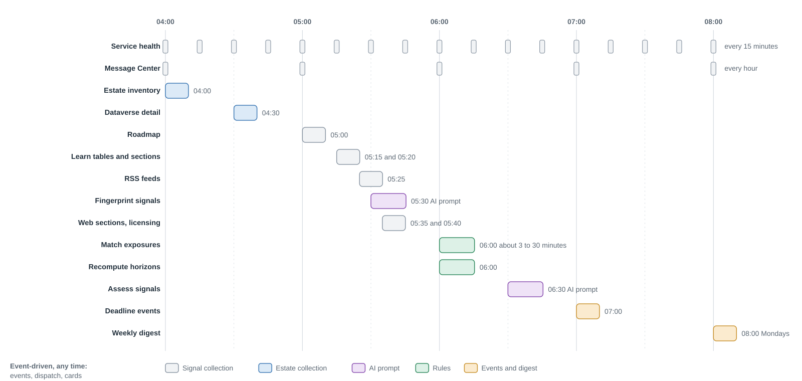

# Operations runbook

> **For:** the platform team who run Change Radar day to day. **Kind:** how-to and reference.
> **Status:** describes release 0.3.0. Every check here is read-only unless it says otherwise. Commands take `-EnvironmentUrl` and `-ExpectedEnvironmentName`, plan by default, and change something only with `-Apply`.
>
> **From:** [Empower Your World](https://www.empoweryour.world/?utm_source=github&utm_medium=docs&utm_campaign=change-radar&utm_content=runbook) · [The story behind Change Radar](https://www.empoweryour.world/blog/change-radar?utm_source=github&utm_medium=docs&utm_campaign=change-radar&utm_content=runbook)

## 1. What runs, and when

All times are UTC. The order matters: the estate is refreshed before matching, signals are collected before fingerprinting, and exposures exist before rating.



| Time (UTC) | Flow | Does |
|---|---|---|
| Every 15 minutes | Collect service health | Incidents and advisories |
| Hourly | Collect Message Center | Message Center posts |
| 04:00 | Collect estate inventory | The tenant's apps, flows and agents |
| 04:30 | Collect Dataverse detail | Solutions, prompts and their callers in each detail environment |
| 05:00 to 05:40 | Roadmap, Learn pages, RSS feeds, web pages, licensing guides | Public sources, as each feed's profile describes |
| 05:30 | Fingerprint signals (AI) | New and changed signals, up to the cap |
| 06:00 | Recompute horizons; Match exposures | Now, Imminent, Future; open, update or close exposures |
| 06:30 | Assess signals (AI) | Ratings, up to the caps |
| 07:00 | Raise deadline events | Deadlines 14 and 3 days away |
| As they happen | Raise signal events, Dispatch events, Notify handlers | Events, queued handler runs, cards and email |
| Monday 08:00 | Digest-Weekly, Digest-Email | The weekly digest |

A night's run takes about 15 minutes in a small environment; matching grows with the estate.

## 2. Routine checks

### 2.1 Daily (5 minutes)

1. **Collection runs** (app: Operations, Collection runs). Each collector has a run since last night. A failed run's name starts "FAILED"; open it for the error. Read the **Gaps** column: it says what wasn't collected and why.
2. **Cards arrived** if anything warranted one. No card for days can mean a quiet week, or a broken Teams connection: see 4.3.
3. **Fingerprints to review** (app: Review). Clear any waiting, or leave them for the platform owner's triage.

### 2.2 Weekly (15 minutes, Monday)

1. The **digest** arrived at 08:00 UTC.
2. The **fingerprint and assess runs' summaries** in Collection runs: signals fingerprinted, rated, prompted and **deferred**. Deferred estate assessments every night mean `assessment_max_per_run` is lower than your estate needs (5.4).
3. **Handler failures:** `Test-Install.ps1` reports handler runs left queued and failed alerts since the alert settings last changed. Read the failed run in the handler flow's history (Power Automate, Solutions, ChangeRadarHandlers): usually a destination or connection.

### 2.3 Monthly (30 minutes)

1. **AI capacity.** Power Platform admin centre, Licensing, AI Builder or Copilot Credits, filtered to the Change Radar environment. Expect about 0.46 Copilot Credits (or 5.5 AI Builder credits) per prompt call. When the environment's AI Builder credits run out, the same calls move to Copilot Credits. Compare with the forecast:
   ```powershell
   ./setup/Get-CreditEstimate.ps1 -EnvironmentUrl https://<org>.crm.dynamics.com -ExpectedEnvironmentName '<environment name>'
   ```
2. **The health check**, one read-only run of every check the install made:
   ```powershell
   ./setup/Test-Install.ps1 -EnvironmentUrl https://<org>.crm.dynamics.com -ExpectedEnvironmentName '<environment name>'
   ```
3. **Overrides and dismissals** from the month: repeated overrides of the same kind suggest a rule or vocabulary change (the Configuration Reference).
4. **Releases:** check for a new Change Radar release and read its notes (section 6).

### 2.4 Quarterly and yearly

| When | Check |
|---|---|
| Quarterly | Access review: who holds Change Radar User and Admin; who receives alerts (`alert_destinations`) |
| Quarterly | Sources and watch list still match what the organisation cares about |
| Quarterly | The connection owner account is active, with its licence, and has a named deputy |
| Yearly, 30 days before expiry | **Renew the reader's certificate** (5.6). Key Vault emails its contacts 30 days before expiry |
| Yearly | Retention jobs are running (5.8); the data protection record is current |

## 3. Health signals

| Where | Healthy | Look closer if |
|---|---|---|
| Collection runs | One run per collector per schedule, Succeeded | Failed, missing, or a gap that doesn't clear the next night |
| Handler flows (Power Automate, ChangeRadarHandlers) | Runs succeed | A failed run: its history says why; `Test-Install.ps1` reports queued runs |
| Radar page header | "Full access" (or the tier you expect), read recently | An older date, or a lower tier than expected |
| Fingerprints to review | A handful at most | Dozens: the threshold may be too high, or a new source needs rules |
| Capacity report | Within the allocation | Above the forecast for two months |

## 4. When something goes wrong

### 4.1 A collector failed

1. Open its **Collection run**: the error and gaps are recorded.
2. Open the flow's run history (Power Automate, Solutions, ChangeRadarCore, the flow, the failed run) to see the failing step.
3. Common causes:

| Symptom | Likely cause | Fix |
|---|---|---|
| Service health or Message Center: 401 or 403 | The reader's certificate expired, or consent was removed | Renew the certificate (5.6); check the app registration's Graph consent |
| Estate inventory: 403 | The connection owner lost Global Reader, or the connection's sign-in expired | Restore the role; fix the connection (4.3) |
| Dataverse detail: 403 for one environment | The reader's application user is missing there | Run `New-ReaderIdentity.ps1` for that environment |
| A public source: no rows, or a parse error | Microsoft changed the page | Check the page; adjust the feed's profile (Adding a Signal Source) |
| Any flow: throttled or timed out | A busy night | Usually clears the next night; rerun the flow by hand if needed |

The next night's run picks up where it can: collectors are idempotent, and nothing over a cap is lost.

### 4.2 The AI steps stopped

**Symptoms:** fingerprint or assess runs record failures; no new ratings. **Likely cause:** AI capacity used up or not allocated, or the prompt's model changed. Check the capacity report; allocate capacity; then the next night's run continues. Collection, matching and alerts keep working meanwhile.

### 4.3 A connection broke

Power Automate, Connections: a broken connection shows a warning. Ask the connection owner to sign in and fix it. Then turn on any flow that was switched off and check the next run.

### 4.4 No cards arrive

1. `./setup/Set-Handlers.ps1 -EnvironmentUrl ... -ExpectedEnvironmentName '...'` lists each handler and whether it's on, and warns about a missing connection or destination.
2. Check `alert_destinations` (Config).
3. Read the handler flow's run history (Power Automate, Solutions, ChangeRadarHandlers): failed runs say why.

### 4.5 Too many cards

Raise the bar: rating only signals in the window (`rating_scope = window`), fewer watch topics, or channel cards instead of chats. Each card type is a subscription that can be switched off (Subscriptions).

## 5. Common tasks

| Task | How |
|---|---|
| 5.1 Turn a handler on or off | `./setup/Set-Handlers.ps1 ... -On Notify-Teams -Apply` (or `-Off`). Its flow and subscriptions switch together |
| 5.2 Change who gets alerts | Config: `alert_destinations` (`chat:`, `channel:`, `email:` entries) and `alert_recipient` |
| 5.3 Read another environment in detail | Add its URL to `detail_environments`, then run `New-ReaderIdentity.ps1` for it to add the reader's application user |
| 5.4 Change the credit caps | Config: `fingerprint_max_per_run`, `rating_max_per_run`, `assessment_max_per_run` |
| 5.5 Add or switch off a source | Operations, Feeds: the **Active** column. To add a new one, see Adding a Signal Source |
| 5.6 Renew the reader's certificate | In Key Vault, create a **new version** of the reader certificate; download its public certificate (.cer) and add it to the reader app registration's **Certificates**; run `./setup/Test-ReaderIdentity.ps1`, which proves the reader signs in and reads; remove the old certificate from the app registration. **Not yet exercised on a live renewal: follow it carefully the first time and record what you find** |
| 5.7 Record a setting Change Radar can't read | Operations, Tenant settings, or `Import-MatchingData.ps1 -TenantSetting @{...}` |
| 5.8 Set retention | Dataverse bulk delete jobs (Power Platform admin centre, the environment, Settings, Data management, Bulk deletion) on collection runs, handler runs, events and the alert log, as decided in the Data Protection Screening |
| 5.9 Switch demo data on or off | The **Demo data** switch in the Radar page header (Admin role), or the `demo_data` setting. Never load demo data in production |
| 5.10 Change the connection owner | The new owner creates new connections; edit each connection reference (Solutions, ChangeRadarCore, Connection references) to use them; turn the flows off and on; check the next runs |
| 5.11 Run a flow now | Power Automate, the flow, **Run**. Run them in schedule order if you run several |

## 6. Upgrades

1. Read the release notes (Release Notes): what changed and any upgrade steps.
2. Check the downloads against their SHA-256 checksums.
3. Import in the order the notes give, with `--async`. Core upgrades use `--stage-and-upgrade`. Flows keep their state, ids and history.
4. Run `Test-Install.ps1` and check the next night's collection runs.

A test environment for upgrades is worth having once Change Radar is relied on (the ALM guide, when written).

## 7. Escalation

| Problem | Who |
|---|---|
| A Microsoft service is down or an API changed | Microsoft support, through your usual route |
| A Change Radar bug | Your platform team first; then a GitHub issue on the repository, with redacted details and never tenant data |
| A security issue in Change Radar | Private reporting (`SECURITY.md`) |
