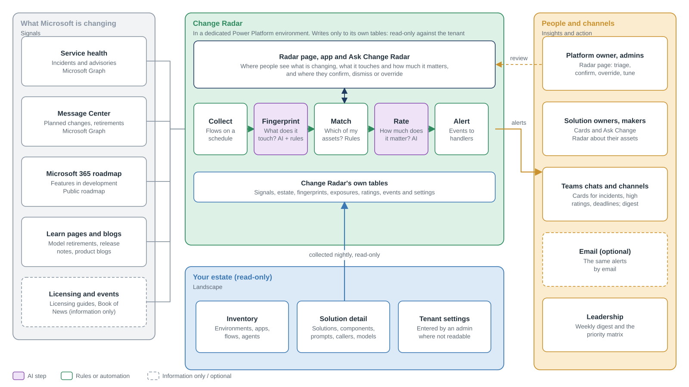

# Solution brief

> **For:** sponsors, platform owners, and anyone deciding whether Change Radar is worth a closer look. **Kind:** explanation.
> **Status:** describes release 0.3.0. Costs are measured in a development environment and two clean installs (November 2026); your own figures will differ.
>
> **From:** [Empower Your World](https://www.empoweryour.world/?utm_source=github&utm_medium=docs&utm_campaign=change-radar&utm_content=overview) · [The story behind Change Radar](https://www.empoweryour.world/blog/change-radar?utm_source=github&utm_medium=docs&utm_campaign=change-radar&utm_content=overview)

**In your organisation.** Copilot, agents and Power Platform are changing every week, and each change lands on an estate that nobody can read in full. The organisations that cope treat keeping up as part of running the platform, not as someone's spare-time reading. For a field report on running AI as a governed, everyday capability, see [The Governed AI Factory](https://www.empoweryour.world/papers/eyw-the-governed-ai-factory-field-report?utm_source=github&utm_medium=docs&utm_campaign=change-radar&utm_content=overview) on Empower Your World.

## The problem

A platform team responsible for Power Platform and Copilot faces three gaps:

- **Volume.** Message Center alone publishes dozens of posts a week. The roadmap, Learn release notes, product blogs and licensing guides add more. Reading them all is a part-time job.
- **Relevance.** A change notice doesn't say whether it touches anything you run. "A model retires on 30 November" matters only if one of your prompts or agents uses it.
- **Timeliness.** By the time someone connects a change to an affected app or flow, the deadline has often passed, and its owner was never told.

## What Change Radar does

It answers three questions, every day, for your estate:

1. **What is changing?** Incidents now, planned changes soon, roadmap items further out.
2. **Does it touch anything we run?** Each change is matched against your environments, solutions, apps, flows, agents, prompts, connectors, models and settings.
3. **So what?** The impact is rated for your estate, the affected assets are named with the evidence, and the right people are told.

## How it works

Each night Change Radar collects Microsoft's announcements and refreshes its copy of your estate. An AI prompt describes each new or changed announcement in a fixed vocabulary; rules then match it against your assets, with no AI involved; a second prompt rates the impact, and rules add weight for production assets and near deadlines. Service health is checked every 15 minutes. The results appear on one page in a model-driven app, as cards in Teams for what's urgent, and as a digest every Monday. People confirm, dismiss and override; every rating is labelled as an AI assessment.

## What it reads, and never writes

- **Reads:** Microsoft's announcements (service health and Message Center through Microsoft Graph; the public roadmap, Learn pages, blogs and licensing guides) and metadata about your apps, flows, agents and prompts.
- **Writes:** only its own tables, in its own environment. It never changes your estate.
- **Sends:** nothing outside Microsoft's cloud. There is no telemetry. Alerts go only to the Teams chats, channels or email addresses you choose, and they ship switched off.

## Who it's for

| Who | Gets |
|---|---|
| Platform owner and admins | A ten-minute daily triage instead of reading Message Center by hand |
| Solution owners and makers | Knowing which changes touch their solution, and what to do |
| Leadership | A weekly picture: what matters most, and when it lands |
| Security, risk and data protection | A read-only tool with a governance pack that answers their questions |

## What it costs

The software is free and open source (Apache License 2.0). You pay only for the Microsoft licences and capacity it uses:

- **Licences:** Power Automate Premium for the account the flows run as; premium Power Apps use rights for people who open the app.
- **AI capacity:** for a small to medium estate, about **5,400 to 7,100 AI Builder credits** (or 455 to 595 Copilot Credits) in the first month, and about **2,200 to 3,700** (185 to 310 Copilot Credits) a month after. Per-run caps hold any month to about 12,400 AI Builder credits at most.
- **Dataverse:** at least 1 GB of database capacity free to create its environment. Its own data is small.

The Licensing and Cost Summary gives the detail.

## What you need to start

A dedicated environment with Dataverse, a Power Platform admin, an Entra admin for one consent, an Azure owner for one Key Vault, and a connection owner. The install takes about half a day, most of it waiting for consent and the first runs.

## Where to go next

| To | Read |
|---|---|
| Decide | The Business Case Kit, and the Licensing and Cost Summary |
| Take it through governance | The Governance Approval Checklist and the governance pack |
| Plan the install | Prerequisites, then the Installation Guide |
| See how it's built | The Architecture Definition |
