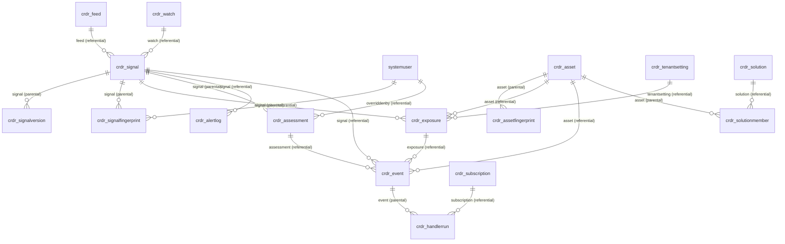

# Change Radar Dataverse schema (design)

> Generated from `schema.json` by `Test-Schema.ps1`. Design only: **not deployed**. Prefix: `crdr` (accepted in ADR 0003 on 2026-11-19).

Rows marked *proposed* aren't in spec §4; they close gaps listed in `docs/overnight/summary.md`.

## Relationships

## `crdr_signal`: Signal

One row per external change: Message Center post, incident, roadmap item, blog post or manual entry.

| Column | Label | Type | Req | Notes |
|---|---|---|---|---|
| `crdr_title` | Title | string(400) | yes |  |
| `crdr_source` | Source | choice `signalsource` | yes |  |
| `crdr_externalid` | External ID | string(100) | yes | MC…, RM… or MO… id |
| `crdr_summary` | Summary | memo(20000) |  |  |
| `crdr_summarytext` | Summary (readable) | memo(20000) |  | Readable plain text of summary, made by the Readable summary flow (engine ConvertTo-ReadableText); summary keeps the text as collected |
| `crdr_products` | Products | string(400) |  | Comma-separated, as published; facets live in signalfingerprint |
| `crdr_horizon` | Horizon | choice `horizon` |  |  |
| `crdr_keydate` | Key date | datetime |  |  |
| `crdr_datelabel` | Date label | string(100) |  |  |
| `crdr_actionrequired` | Action required | bool |  |  |
| `crdr_url` | URL | url(500) |  |  |
| `crdr_firstseen` | First seen | datetime | yes |  |
| `crdr_lastchanged` | Last changed | datetime |  |  |
| `crdr_confidencelabel` | Confidence label | string(50) |  | e.g. 'community archive' for lower-confidence sources (§3.1) |
| `crdr_fingerprintedon` | Fingerprinted on | datetime |  | When the fingerprint flow last fingerprinted this signal; refingerprinted when lastchanged is later (ADR 0009) |
| `crdr_genericimpact` | Generic impact | choice `impact` |  | LLM generic rating for a typical enterprise, set once per signal (ADR 0012) |
| `crdr_nature` | Nature | choice `nature` |  | Type of change (LLM, ADR 0012) |
| `crdr_impacttype` | Impact type | choice `impacttype` |  | Risk, opportunity, or both (LLM opportunity lens, spec §6, ADR 0012) |
| `crdr_risk` | Risk | string(1000) |  | One-sentence risk for a typical enterprise (LLM) |
| `crdr_opportunity` | Opportunity | string(1000) |  | One-sentence opportunity: advisory, governance, adoption, content (LLM) |
| `crdr_audience` | Audience | string(200) |  | Who needs to know, semicolon-separated (LLM) |
| `crdr_theme` | Theme | string(100) |  | One theme from seed/themes.csv (LLM, checked against the list) |
| `crdr_ratingconfidence` | Rating confidence | string(20) |  | high, medium or low (LLM) |
| `crdr_ratedon` | Rated on | datetime |  | When the signal-level rating was set; it is set again only when the signal changes (ADR 0012) |
| `crdr_feed` | Feed | lookup → `feed` |  | The feed that collected this signal when source is feed (ADR 0014) |
| `crdr_watched` | Watched | bool |  | On the watch list: changes to it raise watch.updated. Set by a matching watch, or by hand (ADR 0015) |
| `crdr_watch` | Watched because of | lookup → `watch` |  | The watch topic that put it on the watch list; empty when watched by hand (ADR 0015) |
| `crdr_watchedon` | Watched on | datetime |  | When a watch topic put it on the watch list (ADR 0015) |

Alternate keys: `source_externalid` (source, externalid)

## `crdr_signalversion`: Signal version

History of a signal, for change tracking and signal.changed events.

| Column | Label | Type | Req | Notes |
|---|---|---|---|---|
| `crdr_name` | Name | string(200) | yes |  |
| `crdr_signal` | Signal | lookup → `signal` | yes |  |
| `crdr_snapshotjson` | Snapshot JSON | memo(100000) |  |  |
| `crdr_capturedon` | Captured on | datetime | yes |  |
| `crdr_changedfields` | Changed fields | string(400) |  |  |

## `crdr_signalfingerprint`: Signal fingerprint

What a signal touches, in the shared vocabulary. 'group' holds alternatives (OR); facets within a group are ANDed.

| Column | Label | Type | Req | Notes |
|---|---|---|---|---|
| `crdr_name` | Name | string(200) | yes |  |
| `crdr_signal` | Signal | lookup → `signal` | yes |  |
| `crdr_group` | Group | string(10) | yes | *proposed* |
| `crdr_facet` | Facet | choice `facet` | yes |  |
| `crdr_value` | Value | string(200) | yes |  |
| `crdr_extractedby` | Extracted by | choice `extractedby` | yes |  |
| `crdr_confidence` | Confidence | decimal |  |  |
| `crdr_reason` | Reason | string(1000) |  | Why the LLM chose this facet (quoted or paraphrased from the signal), shown in the review queue (ADR 0009) |
| `crdr_status` | Status | choice `fingerprintstatus` | yes | Review queue (spec gap G11); *proposed* |
| `crdr_reviewedby` | Reviewed by | lookup → `systemuser` |  | *proposed* |

## `crdr_asset`: Asset

One row per estate resource. Keyed on stable source ids so E1 needs no rework.

| Column | Label | Type | Req | Notes |
|---|---|---|---|---|
| `crdr_name` | Name | string(400) | yes |  |
| `crdr_resourcetype` | Resource type | string(100) | yes | Inventory type, e.g. microsoft.powerapps/canvasapps |
| `crdr_environmentid` | Environment ID | string(100) | yes |  |
| `crdr_environmentname` | Environment name | string(200) |  |  |
| `crdr_environmenttype` | Environment type | choice `environmenttype` |  |  |
| `crdr_solutionuniquename` | Solution unique name | string(200) |  |  |
| `crdr_microsoftsystem` | Microsoft system component | bool |  | Shipped by a Microsoft publisher (e.g. a system prompt): its exposures are shown with status system and never rated or alerted (Simon, 2026-11-22) |
| `crdr_managed` | Managed | bool |  |  |
| `crdr_ownerobjectid` | Owner object ID | string(100) |  | Entra object id; not a lookup, owners aren't Dataverse users |
| `crdr_ownerkind` | Owner kind | string(50) |  |  |
| `crdr_lastmodified` | Last modified | datetime |  |  |
| `crdr_sourceid` | Source ID | string(300) | yes | environment id + resource id + solution unique name |
| `crdr_source` | Source | choice `assetsource` | yes | Indexed: drives the 'Demo data' badge |
| `crdr_syntheticorg` | Synthetic organisation | string(200) |  | Required when source is not live |
| `crdr_criticality` | Criticality | choice `impact` |  | Populated by E1 later; ignored in v1 |
| `crdr_lastseen` | Last seen | datetime |  |  |
| `crdr_componentid` | Component ID | string(100) |  | Dataverse component id from inventory: appModuleId (model-driven app), workflowEntityId (flow), name (canvas app). Joins Dataverse detail to the asset (ADR 0008) |

Alternate keys: `sourceid` (sourceid)

## `crdr_assetfingerprint`: Asset fingerprint

What an asset uses, in the shared vocabulary, with the source field as evidence.

| Column | Label | Type | Req | Notes |
|---|---|---|---|---|
| `crdr_name` | Name | string(200) | yes |  |
| `crdr_asset` | Asset | lookup → `asset` | yes |  |
| `crdr_facet` | Facet | choice `facet` | yes |  |
| `crdr_value` | Value | string(200) | yes |  |
| `crdr_evidence` | Evidence | string(1000) |  |  |

## `crdr_tenantsetting`: Tenant setting *(proposed)*

Tenant-level settings for setting checks (spending policies, subprocessors). Manual at first.

| Column | Label | Type | Req | Notes |
|---|---|---|---|---|
| `crdr_key` | Key | string(100) | yes |  |
| `crdr_state` | State | choice `settingstate` | yes |  |
| `crdr_scope` | Scope | string(400) |  | Products the setting covers |
| `crdr_evidence` | Evidence | string(1000) |  |  |
| `crdr_checkedon` | Checked on | datetime |  |  |

Alternate keys: `key` (key)

## `crdr_rule`: Rule

Deterministic facet joins. Seeded from seed/rules.csv.

| Column | Label | Type | Req | Notes |
|---|---|---|---|---|
| `crdr_name` | Name | string(200) | yes |  |
| `crdr_rulecode` | Rule code | string(50) | yes | Stable rule identifier, e.g. R-PRODUCT (rule_id in seed/rules.csv) |
| `crdr_signalfacet` | Signal facet | choice `facet` | yes |  |
| `crdr_assetfacet` | Asset facet | choice `facet` | yes |  |
| `crdr_condition` | Condition | choice `rulecondition` | yes |  |
| `crdr_role` | Role | choice `rulerole` | yes | *proposed* |
| `crdr_active` | Active | bool | yes |  |
| `crdr_description` | Description | memo(2000) |  |  |

Alternate keys: `rulecode` (rulecode)

## `crdr_facetvalue`: Facet value *(proposed)*

The shared vocabulary. Seeded from seed/vocabulary.csv; installers can add values.

| Column | Label | Type | Req | Notes |
|---|---|---|---|---|
| `crdr_name` | Name | string(250) | yes | facet: value, e.g. 'connector: shared_sharepointonline'. Primary name, so not used in the key (primary name columns are stored at 850 characters) |
| `crdr_value` | Value | string(200) | yes |  |
| `crdr_facet` | Facet | choice `facet` | yes |  |
| `crdr_description` | Description | string(500) |  |  |
| `crdr_active` | Active | bool | yes |  |
| `crdr_aliases` | Aliases | string(1000) |  | Other spellings of the value, separated by '|' (model facet, ADR 0013): matched ignoring case |

Alternate keys: `facet_value` (facet, value)

## `crdr_exposure`: Exposure

Signal × asset (or tenant setting) match, with evidence.

| Column | Label | Type | Req | Notes |
|---|---|---|---|---|
| `crdr_name` | Name | string(400) | yes |  |
| `crdr_signal` | Signal | lookup → `signal` | yes |  |
| `crdr_asset` | Asset | lookup → `asset` |  | Empty for setting exposures |
| `crdr_tenantsetting` | Tenant setting | lookup → `tenantsetting` |  | *proposed* |
| `crdr_group` | Group | string(10) |  | *proposed* |
| `crdr_matchedfacets` | Matched facets | string(400) |  |  |
| `crdr_rules` | Rules | string(400) |  | Rule ids that matched; multi-rule matches are normal |
| `crdr_evidencetext` | Evidence text | memo(10000) |  |  |
| `crdr_status` | Status | choice `exposurestatus` | yes |  |
| `crdr_source` | Source | choice `assetsource` | yes | Copied from asset so ratings never mix live and synthetic; *proposed* |

Alternate keys: `signal_asset` (signal, asset)

## `crdr_assessment`: Assessment

Estate-specific rating per signal, with an override.

| Column | Label | Type | Req | Notes |
|---|---|---|---|---|
| `crdr_name` | Name | string(400) | yes |  |
| `crdr_signal` | Signal | lookup → `signal` | yes |  |
| `crdr_genericimpact` | Generic impact | choice `impact` |  |  |
| `crdr_estateimpact` | Estate impact | choice `impact` |  |  |
| `crdr_nature` | Nature | choice `nature` |  |  |
| `crdr_affectedcount` | Affected count | int |  |  |
| `crdr_rationale` | Rationale | memo(10000) |  | LLM-written; labelled as assessment, not fact |
| `crdr_recommendedaction` | Recommended action | memo(4000) |  |  |
| `crdr_model` | Model | string(100) |  |  |
| `crdr_assessedon` | Assessed on | datetime |  |  |
| `crdr_overrideimpact` | Override impact | choice `impact` |  | Impact set by a reviewer, overriding the estate impact |
| `crdr_overriddenby` | Overridden by | lookup → `systemuser` |  |  |
| `crdr_overridereason` | Override reason | memo(2000) |  |  |
| `crdr_source` | Source | choice `assetsource` | yes | *proposed* |
| `crdr_unknownenvcount` | Unknown environment count | int |  | Exposed assets whose environment type is unknown: no production bonus for them (ADR 0010) |
| `crdr_productionbonus` | Production bonus | bool |  | +1 applied: an exposed asset is in a production environment |
| `crdr_actionbonus` | Action bonus | bool |  | +1 applied: action required and the key date is within 30 days or past |
| `crdr_exposuresummary` | Estate summary (sent to the prompt) | memo(4000) |  | The names-free estate summary sent to the assessment prompt; the prompt runs again only when it or the signal changes |
| `crdr_overriddenon` | Overridden on | datetime |  | When the override was last set or changed |

## `crdr_alertlog`: Alert log

| Column | Label | Type | Req | Notes |
|---|---|---|---|---|
| `crdr_name` | Name | string(200) | yes |  |
| `crdr_signal` | Signal | lookup → `signal` | yes |  |
| `crdr_channel` | Channel | choice `alertchannel` | yes |  |
| `crdr_senton` | Sent on | datetime | yes |  |
| `crdr_severity` | Severity | choice `impact` |  |  |

## `crdr_event`: Event

Raised by each pipeline step; the dispatcher triggers on new rows.

| Column | Label | Type | Req | Notes |
|---|---|---|---|---|
| `crdr_name` | Name | string(200) | yes |  |
| `crdr_eventtype` | Event type | choice `eventtype` | yes |  |
| `crdr_signal` | Signal | lookup → `signal` |  |  |
| `crdr_exposure` | Exposure | lookup → `exposure` |  |  |
| `crdr_assessment` | Assessment | lookup → `assessment` |  |  |
| `crdr_asset` | Asset | lookup → `asset` |  |  |
| `crdr_payloadjson` | Payload JSON | memo(20000) |  |  |
| `crdr_raisedon` | Raised on | datetime | yes |  |
| `crdr_correlationid` | Correlation ID | string(100) | yes |  |

## `crdr_subscription`: Subscription

| Column | Label | Type | Req | Notes |
|---|---|---|---|---|
| `crdr_name` | Name | string(200) | yes |  |
| `crdr_eventtype` | Event type | choice `eventtype` | yes |  |
| `crdr_filterproduct` | Filter: product | string(200) |  |  |
| `crdr_filterminimpact` | Filter: minimum impact | choice `impact` |  |  |
| `crdr_filternature` | Filter: nature | choice `nature` |  |  |
| `crdr_handler` | Handler | string(200) | yes | Child flow name |
| `crdr_enabled` | Enabled | bool | yes |  |
| `crdr_writes` | Writes outside Change Radar | bool | yes | Handlers that write outside Change Radar ship disabled |

## `crdr_handlerrun`: Handler run *(proposed)*

Idempotency log: what each handler did for each event.

| Column | Label | Type | Req | Notes |
|---|---|---|---|---|
| `crdr_name` | Name | string(200) | yes |  |
| `crdr_event` | Event | lookup → `event` | yes |  |
| `crdr_subscription` | Subscription | lookup → `subscription` | yes |  |
| `crdr_outcome` | Outcome | choice `handleroutcome` | yes |  |
| `crdr_detail` | Detail | memo(4000) |  |  |
| `crdr_ranon` | Ran on | datetime | yes |  |

Alternate keys: `event_subscription` (event, subscription)

## `crdr_collectionrun`: Collection run *(proposed)*

One row per collector run, recording the detected access tier so the dashboard can show it.

| Column | Label | Type | Req | Notes |
|---|---|---|---|---|
| `crdr_name` | Name | string(200) | yes |  |
| `crdr_collector` | Collector | string(100) | yes |  |
| `crdr_accesstier` | Access tier | choice `accesstier` | yes |  |
| `crdr_startedon` | Started on | datetime | yes |  |
| `crdr_itemcount` | Item count | int |  |  |
| `crdr_gaps` | Gaps | memo(4000) |  | What this tier couldn't see |

## `crdr_config`: Config

Installer-editable settings. Seeded from seed/config.csv.

| Column | Label | Type | Req | Notes |
|---|---|---|---|---|
| `crdr_key` | Key | string(100) | yes |  |
| `crdr_value` | Value | string(2000) |  |  |
| `crdr_description` | Description | string(1000) |  |  |

Alternate keys: `key` (key)

## `crdr_feed`: Feed

A configurable signal source read by the generic Collect feeds flow. Seeded from seed/feeds.csv and seed/feed-profiles/ (ADR 0014).

| Column | Label | Type | Req | Notes |
|---|---|---|---|---|
| `crdr_name` | Name | string(200) | yes |  |
| `crdr_key` | Key | string(20) | yes | Prefix for external ids, e.g. ML-PR |
| `crdr_kind` | Kind | choice `feedkind` | yes |  |
| `crdr_url` | URL | url(500) | yes |  |
| `crdr_products` | Products | string(400) |  |  |
| `crdr_horizonrule` | Horizon rule | choice `horizonrule` | yes |  |
| `crdr_profile` | Profile | memo(20000) |  | JSON: table profiles, sections and keywords, or RSS label |
| `crdr_active` | Active | bool | yes |  |
| `crdr_lastmarker` | Last marker | string(100) |  | Page git_commit_id or newest item date; an unchanged source is skipped |
| `crdr_lastcheckedon` | Last checked on | datetime |  |  |
| `crdr_description` | Description | memo(2000) |  |  |
| `crdr_unrated` | Unrated | bool |  | Signals from this feed are never fingerprinted or rated by the LLM; they feed the watch list and Ask Change Radar only (ADR 0018, ADR 0019) |

Alternate keys: `key` (key)

## `crdr_watch`: Watch

A watch list topic: new or changed signals whose title or summary match it go on the watch list and raise watch.matched; changes to watched signals raise watch.updated (ADR 0015).

| Column | Label | Type | Req | Notes |
|---|---|---|---|---|
| `crdr_name` | Name | string(200) | yes |  |
| `crdr_anyof` | Any of these words | string(1000) | yes | Semicolon-separated words or phrases; one must appear (whole words, any case) |
| `crdr_alsooneof` | And one of these words | string(1000) |  | Optional: semicolon-separated; one of these must appear too |
| `crdr_ignorephrases` | Ignore these phrases | string(1000) |  | Optional: semicolon-separated phrases removed before checking, e.g. Windows Autopilot |
| `crdr_products` | Products | string(400) |  | Optional: semicolon-separated; one must be in the signal's products |
| `crdr_active` | Active | bool | yes |  |
| `crdr_description` | Description | memo(2000) |  |  |

## `crdr_solution`: Solution

A Dataverse solution that holds estate assets, per environment (ADR 0020). Default, Active and the Common Data Services Default Solution are never stored. Written by the detail flow (live) and the estate import (synthetic).

| Column | Label | Type | Req | Notes |
|---|---|---|---|---|
| `crdr_name` | Name | string(200) | yes | Display name |
| `crdr_uniquename` | Unique name | string(200) | yes |  |
| `crdr_environmentid` | Environment ID | string(100) | yes |  |
| `crdr_environmentname` | Environment name | string(200) |  |  |
| `crdr_publisher` | Publisher | string(200) |  | Publisher unique name |
| `crdr_managed` | Managed | bool |  |  |
| `crdr_microsoft` | Published by Microsoft | bool |  | Published by a Microsoft publisher (seed/asset-signatures.json pcfMicrosoftPublishers): grouped as Microsoft solutions |
| `crdr_source` | Source | choice `assetsource` | yes | live or synthetic, as the assets it holds |
| `crdr_syntheticorg` | Synthetic organisation | string(200) |  |  |

Alternate keys: `environmentid_uniquename` (environmentid, uniquename)

## `crdr_solutionmember`: Solution member

An asset's membership of a solution (ADR 0020). One asset can be in several solutions. Rows that no longer hold are deleted by the detail flow.

| Column | Label | Type | Req | Notes |
|---|---|---|---|---|
| `crdr_name` | Name | string(400) | yes | Asset name in solution name |
| `crdr_asset` | Asset | lookup → `asset` | yes |  |
| `crdr_solution` | Solution | lookup → `solution` | yes | Referential: a table can have only one parental relationship (asset). The detail flow deletes a solution's member rows before the solution |
| `crdr_source` | Source | choice `assetsource` | yes |  |

## Choices

| Choice | Values (ordinal order) |
|---|---|
| `crdr_signalsource` | graph_mc, graph_health, roadmap, blog, community_archive, manual, feed |
| `crdr_feedkind` | learnpage_tables, learnpage_sections, rss, webpage_sections, pdf_changelog |
| `crdr_horizonrule` | lifecycle, released, published |
| `crdr_horizon` | now, imminent, future |
| `crdr_facet` | product, resource_type, connector, capability, auth_mode, harness, setting, environment_type, model |
| `crdr_extractedby` | rule, llm, manual |
| `crdr_fingerprintstatus` | accepted, review, rejected |
| `crdr_assetsource` | live, fixture, synthetic |
| `crdr_environmenttype` | production, sandbox, developer, default, trial |
| `crdr_exposurestatus` | new, confirmed, dismissed, unmatched, system |
| `crdr_impacttype` | risk, opportunity, risk_and_opportunity |
| `crdr_impact` | none, low, medium, high, critical |
| `crdr_nature` | breaking, deprecation, behaviour_change, new_capability, licensing, incident, informational |
| `crdr_rulerole` | scope, trigger, setting |
| `crdr_rulecondition` | any, setting_absent |
| `crdr_eventtype` | signal.new, signal.changed, incident.opened, incident.resolved, exposure.found, assessment.rated, deadline.approaching, idea.enabled, asset.modelchanged, watch.matched, watch.updated |
| `crdr_alertchannel` | teams_channel, teams_chat, email_digest, email |
| `crdr_accesstier` | full, reader, maker, public |
| `crdr_handleroutcome` | succeeded, skipped_duplicate, failed, queued |
| `crdr_settingstate` | enabled, disabled, not_configured |
